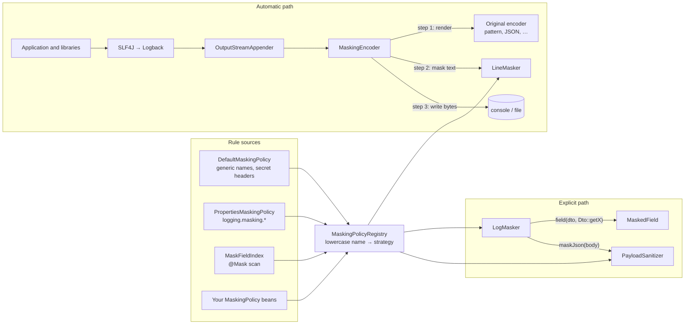
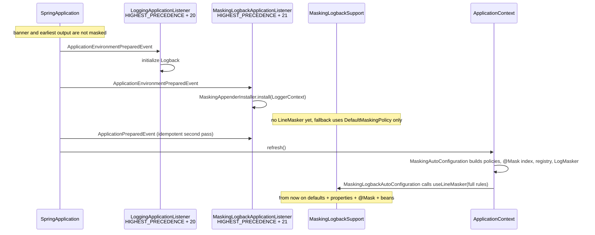
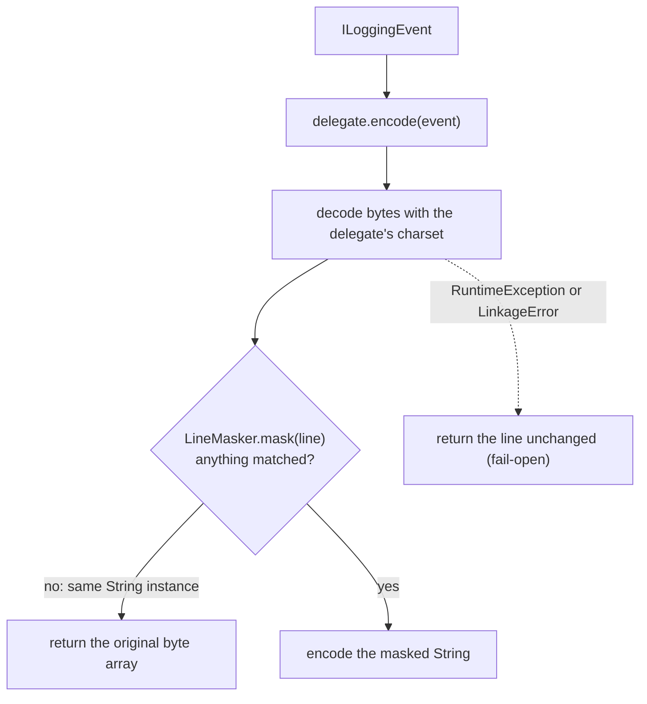
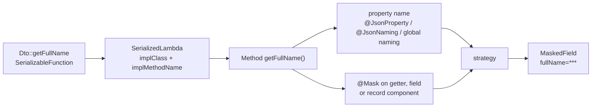

# Architecture

English · [Русский](architecture.ru.md)

This document explains how the starter is put together: where rules come from, how a log line is
masked on its way to the appender, how the explicit `LogMasker` API works, and which trade-offs were
made deliberately. User-facing behavior is described in the [README](../README.md).

## The idea in one picture

There are two paths that share one set of rules:

- **Automatic path.** Every supported Logback appender gets its encoder wrapped. The wrapper lets the
  original encoder render the line, then masks the rendered text by field name before the bytes are
  written. Application code, library code, MDC and stack traces all pass through it.
- **Explicit path.** `LogMasker` covers what the automatic path cannot see: an unnamed value passed to
  a placeholder, or a raw JSON body that is about to be logged or sent elsewhere.

## Packages

| Package | Depends on | Responsibility |
|---|---|---|
| `core` | JDK, Jackson, SLF4J API | Policies, the registry, the line scanner, strategies, `LogMasker`, `@Mask`. No Spring, no Logback. |
| `adapter.logback` | `core`, Logback | `MaskingEncoder`, appender traversal, the static holder used by encoders. |
| `autoconfigure` | `core`, adapter, Spring Boot | Properties, bean wiring, the early startup listener, the `@Mask` classpath scanner. |

`core` is logger-independent on purpose: a future Log4j2 adapter ([roadmap F4](roadmap.md)) reuses the
same scanner and registry and only adds its own layout wrapper.

| Class | Role |
|---|---|
| `MaskingPolicy` | Extension point. Contributes masked names, explicit strategies, secret headers and contextual names. All methods have defaults. |
| `DefaultMaskingPolicy` | Generic personal-data and secret names plus secret headers. Disabled with `use-default-fields: false`. |
| `PropertiesMaskingPolicy` | Adapts `logging.masking.*` to a `MaskingPolicy`, inverting `field-strategies` groups. |
| `MaskFieldIndex` | Names collected from `@Mask(scope = ALL)`. It is itself a `MaskingPolicy`. |
| `MaskingPolicyRegistry` | Merges every policy into one immutable lookup, including allocation-free lookups on substrings. |
| `LineMasker` | Single-pass scanner for rendered, mixed-format text. |
| `MaskingFunctions` | `FULL`, `LAST4`, `HASH` implementations. |
| `MaskingEncoder` | Logback encoder wrapper around the original encoder. |
| `MaskingAppenderInstaller` | Walks loggers and nested appenders, wraps encoders, reports uncovered appenders. |
| `MaskingLogbackSupport` | Static holder of the current `LineMasker`, with a defaults-only fallback. |
| `MaskingLogbackApplicationListener` | Installs wrappers right after Spring Boot initializes Logback. |
| `LogMasker`, `MaskedField` | Explicit API for unnamed values and JSON bodies. |
| `MethodReferenceResolver`, `MemberNames` | Turn `Dto::getFullName` into a field name and strategy, respecting Jackson naming. |
| `PayloadSanitizer` | Tree-based JSON masking with a size limit and contextual rules. |
| `MaskFieldIndexScanner` | Finds `@Mask` in application packages without loading unrelated classes. |

## Rules: from four sources to one lookup

`MaskingPolicyRegistry` is built once and never changes. It receives the policies in this order:
`DefaultMaskingPolicy` (if enabled), then every `MaskingPolicy` bean in Spring order.
`PropertiesMaskingPolicy` and `MaskFieldIndex` are ordinary beans of that type.

Merging happens in two stages so that configuration can relax a default name without removing it:

1. Every name from `maskedFields()` of every policy is entered with `FULL`.
2. Every entry from `fieldStrategies()` overrides stage 1. When two policies give the same name different
   explicit strategies, the stronger one wins: `FULL > HASH > LAST4`. Bean order does not matter.

Secret headers are kept in a separate set and always use `FULL`; a field strategy cannot turn a header
into a partial mask. All names are lowercased with `Locale.ROOT`.

For the hot path the registry also builds two small open-addressing hash tables (`NameTable`): one for
all names plus headers, one for headers only. They look up a name directly in `line[start, end)` and
lowercase characters on the fly, so scanning a log line does not allocate a substring or a lowercase
copy for every candidate key. Tables are at most half full and sized at startup.

`contextualMaskedFields(siblings)` is evaluated per JSON object, because the answer depends on which
other fields are present. It is used only by `PayloadSanitizer`.

## Startup: when masking becomes active

Logback is created long before the Spring context and its beans exist. The starter therefore works in
two phases.

- The listener is registered through `META-INF/spring.factories`, not as a bean, because it has to run
  before the context exists. Its order is exactly one step after Boot's `LoggingApplicationListener`:
  earlier, the appenders do not exist yet; later, startup lines could slip through unwrapped.
- The second pass on `ApplicationPreparedEvent` handles logging re-initialization (for example after a
  profile changes the configuration). Installation is idempotent: already wrapped encoders are counted,
  not wrapped again.
- The listener reads `logging.masking.enabled` and `logging.masking.mode` straight from the
  `Environment`. An unknown mode is treated as `encoder` here, so a typo cannot silently switch masking
  off before the context starts. Property binding later rejects the same value and fails startup.
- `MaskingLogbackAutoConfiguration` publishes the context `LineMasker` through an `InitializingBean`.
  The holder field is `volatile`, so encoders on other threads switch over without locking.

The resulting coverage windows are documented in the README limitations: nothing before Logback
initialization, generic defaults until the context is ready, full rules afterwards.

## The automatic path: encoder wrapping

### Installation

`MaskingAppenderInstaller` iterates over every logger in the `LoggerContext` and every attached
appender. Composite appenders (`AppenderAttachable`, for example `AsyncAppender`) are traversed
recursively. An identity set prevents visiting a shared appender twice.

- `OutputStreamAppender` with an encoder (console, file, rolling file): the encoder is replaced by
  `MaskingEncoder(original)`.
- An appender without an encoder (`SocketAppender`, `SyslogAppender`, `SMTPAppender`, custom ones):
  reported as unsupported. The listener logs a startup warning naming these classes.

### Encoding a line

- The wrapper masks the **rendered** output. Whatever the layout put into the line — message,
  arguments, MDC, markers, the stack trace — is visible to the scanner. Third-party libraries need no
  cooperation.
- The charset is taken from the delegate when it is a `LayoutWrappingEncoder`; using another charset
  could corrupt non-ASCII output.
- `LineMasker` returns the same `String` instance when nothing matched. The encoder detects this with an
  identity check and returns the original bytes without re-encoding. Most lines contain nothing to mask,
  so this is the common case.
- Header and footer bytes, `start()` and `stop()` are delegated.

### The line scanner

`LineMasker` scans the line once from left to right. It allocates a `StringBuilder` only at the first
match; until then it only reads characters. It reacts to three triggers:

| Trigger | Names looked up | Where the value ends |
|---|---|---|
| `"key":` (a quoted key followed by a colon) | all masked names and secret headers | end of the JSON value: a string, a balanced `{…}`/`[…]`, or a scalar up to `,` `}` `]`, a space or a line break |
| `key=` | all masked names and secret headers | a quoted value, a balanced `(…)`/`[…]`/`{…}`, or text up to `,` `)` `]` `}` `&` or a line break |
| `Key:` (bare colon) | **secret headers only** | same as `key=` |

Details that follow from this table:

- The key is read backwards from the separator: letters, digits, `_`, `$` and `-` (so `X-Auth-Token`
  is one name). A dot separates, so `user.email=` matches `email`. Spaces before `=` are allowed. Keys
  longer than 64 characters are ignored.
- Spaces belong to plain values: `fullName=John Smith` is masked whole. A comma ends a plain value, so
  `fullName=Smith, John` leaves `John` visible. This is the price of masking arbitrary text without a
  grammar; the README documents it.
- A bare `Name: value` is matched only for secret headers. An ordinary label such as `Comment:` often
  introduces free prose with no reliable end, and masking it could swallow the rest of the message.
- `null` is preserved: it says the value is absent, which is useful and not sensitive.
- Structured encoders put the whole message inside one JSON string. The scanner therefore keeps scanning
  inside quoted fragments that are not keys, and the closing quote of the enclosing fragment caps the
  end of a plain value. A replacement never consumes the closing quote and the rest of the JSON entry.
- `FULL` inserts the constant `***` without reading the value. `LAST4` and `HASH` strip surrounding
  quotes first, so `'1234 5678'` and `"1234 5678"` give the same result. In JSON, the replacement is
  always written as a string: `"***"`.
- A `HASH` field whose value already has the hash form (`#` and eight lowercase hex characters) is left
  as is. `FULL` and `LAST4` give the same result when applied twice; `HASH` would not, and `maskJson`
  output reaches the encoder already hashed.

### Already masked arguments

`MaskingEncoder` passes the event's argument array to `LineMasker.mask(line, arguments)`. When the
scanner reaches `name=` and the line continues with exactly the rendering of a `MaskedField` argument
of that name, it copies the pair verbatim and resumes after it. Without this, the encoder would mask
the pair again: hash a hash, replace a member's `@Mask` strategy with the global one, and — since
spaces belong to plain values — swallow the message text after the placeholder.

Only `MaskedField` instances are trusted, never strings with the same text. The rendered pair contains
just the name and an already masked value, so keeping it discloses nothing. A letter or digit right
after it means the text merely starts like the field (a longer raw value) and is masked as usual.
A secret header is kept only when the field is fully masked; a member `@Mask` with a partial
strategy cannot weaken a header. Lines without `MaskedField` arguments take the unchanged path.

### Failure behavior

`MaskingLogbackSupport.maskLine` catches `RuntimeException` and `LinkageError` and returns the original
line. It does not log the failure, because logging from inside an encoder would recurse into the same
appender. This is a conscious choice for availability over secrecy: a bug in the scanner must not stop
the application from logging. The README lists it as a limitation.

## The explicit path: `LogMasker`

### `field(dto, Dto::getFullName)`

1. `SerializableFunction` makes the compiler generate a serializable lambda. The resolver obtains its
   `SerializedLambda` by running the lambda through an `ObjectOutputStream` that writes to a null stream
   and captures the object in `replaceObject`. Nothing is actually serialized; this avoids reflective
   access to the private `writeReplace` of a hidden class, which can fail in named modules.
2. Only unbound instance method references are accepted. Lambda bodies, bound references
   (`dto::getFullName`) and static methods are rejected with `IllegalArgumentException`, because a field
   name cannot be derived from them.
3. The method is found on the implementation class (`getMethod` first, so inherited public and interface
   default methods are found). `getX`/`isX` become `x`; record accessors keep their name.
4. The name is the `@JsonProperty` value if present, otherwise the Java name translated by the class's
   `@JsonNaming` or the global `ObjectMapper` naming strategy.
5. Strategy: `@Mask` on the getter, field or record component wins, including `TYPED` members that are
   not in the global index. Otherwise the registry is asked for each spelling. A name unknown to every
   policy is masked with `FULL`, and a warning is logged once.
6. The result is cached per lambda class in a `ClassValue`, which effectively means once per call site.

`field("name", value)` skips steps 1–4 and asks the registry directly; unknown names get `FULL` and one
warning per name (bounded to 1,000 distinct names).

`MaskedField` is the object passed to SLF4J. It renders `name=masked` lazily in `toString()` and caches
it, so nothing is computed when the log level is disabled.

### `maskJson(body)`

`PayloadSanitizer` handles complete JSON documents, typically request or response bodies:

1. Bodies larger than `max-body-size` (UTF-8 bytes) are replaced with a short notice, without parsing.
2. The body is parsed into a Jackson tree with a private copy of the application's `ObjectMapper`.
3. For each object the sanitizer collects sibling names, asks the registry for contextual names, then
   replaces matching values with `MaskingFunctions.apply(...)` and recurses into the rest.
4. Malformed JSON becomes `body omitted` rather than leaking a partially parsed body.

This path knows the document structure, so it is the only place where contextual rules (a field that is
sensitive only next to particular siblings) can be applied.

## `@Mask` index

The encoder sees text, not objects, so annotations have to be converted into names ahead of time.

1. Packages: `logging.masking.scan-packages`, or the auto-configuration packages of the
   `@SpringBootApplication` when empty.
2. Every `.class` resource in those packages is read as bytes and searched for the annotation
   descriptor `Lio/github/laipan009/logmasking/core/Mask;`. Classes without it are never loaded. This
   keeps startup cheap in large applications where only a few DTOs are annotated.
3. Matching classes are loaded and inspected: record components, non-static fields and no-argument
   instance methods.
4. For `@Mask(scope = ALL)` the index stores the Java name, the `@JsonProperty` name and the name
   translated by the naming strategy, all with the same strategy. `TYPED` members are skipped.
5. The scan logs one summary line with the class count, time and the first 20 names.

Because matching is by name, `@Mask String comment` in one DTO masks `comment=` in every log line.
`TYPED` exists for exactly the cases where that is too broad.

## Extension points

| Need | Mechanism |
|---|---|
| Fixed list of extra names, headers or strategies | `logging.masking.*` properties |
| Names that belong to a DTO | `@Mask` |
| Computed names, shared company-wide rules, contextual JSON rules | a `MaskingPolicy` bean (or several) |
| Replace a component entirely | every bean in `MaskingAutoConfiguration` and `LineMasker` is `@ConditionalOnMissingBean` |
| Turn off automatic masking but keep `LogMasker` | `logging.masking.mode: off` |
| Turn everything off | `logging.masking.enabled: false` |

Organization-specific rules belong in the consuming application or a private companion library, not
in a fork of this engine. See [releasing.md](releasing.md) for the recommended setup.

## Design decisions

**Wrap the encoder rather than the message.** A custom `%msg` converter would need every pattern to
change and would miss MDC and stack traces. Rewriting `ILoggingEvent` before appenders is not possible
in a general way, and structured encoders build their output from many event parts. Wrapping the
encoder sees the final text of any layout, needs no change to `logback-spring.xml`, and keeps the
original encoder fully responsible for formatting.

**Match by name, not by content.** Recognizing arbitrary personal data by its shape (card numbers,
phone formats, names) is unreliable and expensive, and false positives destroy diagnostic value. Names
are explicit, testable and cheap to look up. The cost is that an unnamed value is invisible to the
encoder; `LogMasker.field` closes that gap.

**Single pass, no regular expressions.** Every line written by the application goes through the
scanner. A hand-written scanner with an allocation-free name table keeps the common no-match case to a
read of the line plus an identity check. `LineMaskerAllocationTest` and the other `perf` tests measure
this.

**Static holder between Logback and Spring.** Logback creates encoders outside Spring, and the wrapper
must work before the context exists. A single `volatile` field with a lazy defaults-only fallback is the
smallest bridge that allows both.

**Fail open.** Losing logs during an incident is worse for most services than a rare unmasked line
caused by a bug. The opposite policy (drop the line) would be a reasonable option to add behind a
property; it is not implemented.

**Restrictive conflict resolution.** When two sources disagree about a strategy, the result must not
depend on bean order, and the safer answer is the one that discloses less.

## Testing

| Level | Examples | What it proves |
|---|---|---|
| Unit | `LineMaskerTest`, `DefaultMaskingPolicyTest`, `MaskingPolicyRegistryTest`, `MaskingFunctionsTest`, `PayloadSanitizerTest`, `LogMaskerTest` | Scanner forms and boundaries, merge rules, strategies, JSON handling, method references. |
| Logback adapter | `MaskingEncoderTest`, `MaskingAppenderInstallerTest`, `MaskingLogbackSupportTest` | Wrapping, charset handling, byte reuse, unsupported appenders, fallback, `LogMasker` output through a real encoder. |
| Auto-configuration | `MaskingAutoConfigurationTest`, `MaskingLogbackAutoConfigurationTest`, `MaskingLogbackApplicationListenerTest`, `MaskFieldIndexScannerTest` | Conditions, properties, listener order and modes, annotation scanning. |
| Integration | `LogPiiCanaryIT`, `LogMaskerFieldIT` | A real Spring Boot application with HTTP calls: canary values must never reach stdout, while neighboring context stays readable. |
| Performance | `LineMaskerAllocationTest`, `MaskJsonPerformanceTest`, `MaskingEncoderPerformanceTest` (`./mvnw test -Pperf`) | Allocation and throughput measurements; excluded from the regular build, no machine-specific thresholds. |
