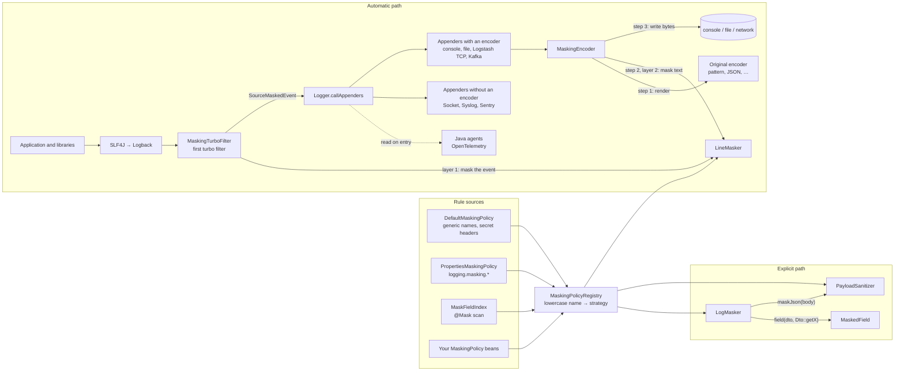
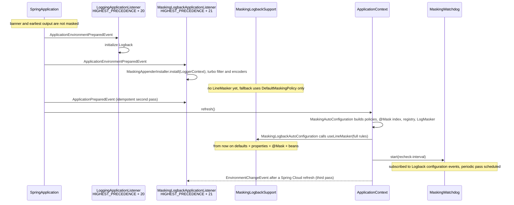
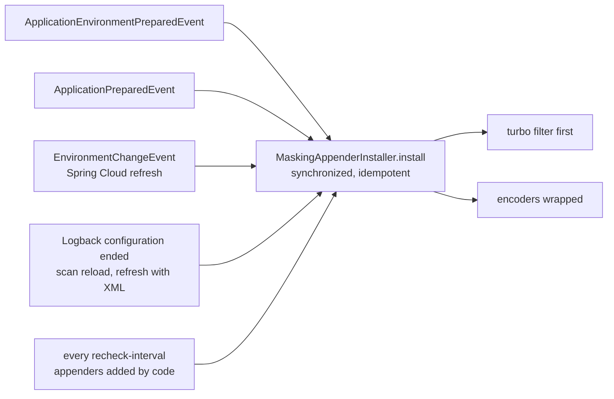
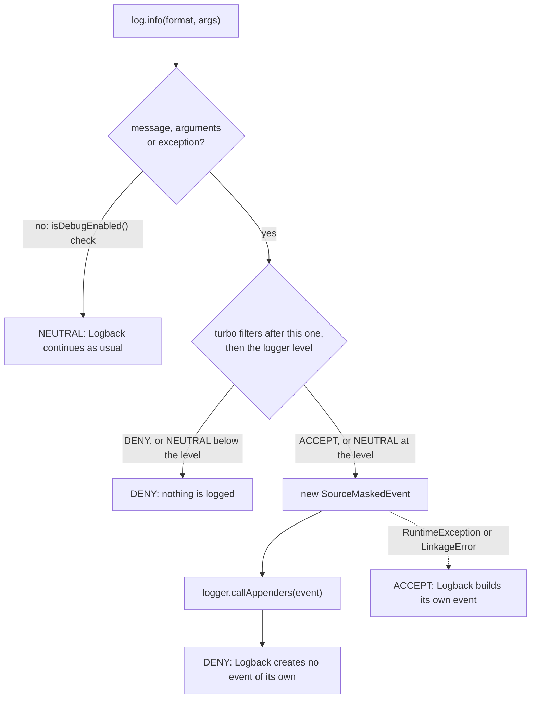
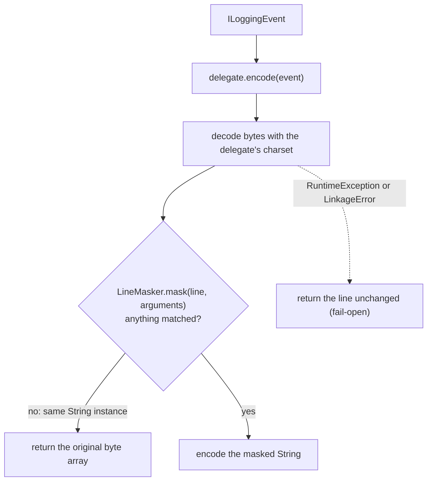
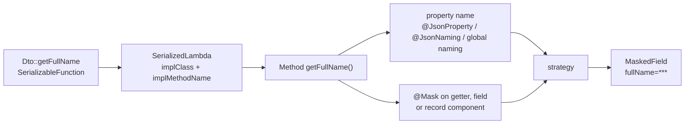

# Architecture

English · [Русский](architecture.ru.md)

This document explains how the starter is put together: where rules come from, how a log event is
masked before appenders read it and again in the encoder, how the explicit `LogMasker` API works, and
which trade-offs were made deliberately. User-facing behavior is described in the
[README](../README.md).

## The idea in one picture

There are two paths that share one set of rules:

- **Automatic path.** Two layers inside Logback. At the source, a turbo filter that runs before
  Logback creates the event builds the event already masked: message, MDC, key-value pairs and
  exception messages. Every consumer of the event receives masked data, including appenders without an
  encoder, Sentry and Java agents such as OpenTelemetry. Behind it, every appender with an encoder gets
  the encoder wrapped: the wrapper lets the original encoder render the line, then masks the rendered
  text by field name before the bytes are written, catching what the encoder adds itself and events
  that bypassed the filter. Application code, library code, MDC and stack traces all pass through both.
- **Explicit path.** `LogMasker` covers what the automatic path cannot see: an unnamed value passed to
  a placeholder, or a raw JSON body that is about to be logged or sent elsewhere.

## Packages

| Package | Depends on | Responsibility |
|---|---|---|
| `core` | JDK, Jackson, SLF4J API | Policies, the registry, the line scanner, strategies, `LogMasker`, `@Mask`. No Spring, no Logback. |
| `adapter.logback` | `core`, Logback | The turbo filter and the masked event, `MaskingEncoder`, appender traversal, the watchdog, the static holder shared by the filter and encoders. |
| `autoconfigure` | `core`, adapter, Spring Boot | Properties, bean wiring, the early startup listener, the `@Mask` classpath scanner. |

`core` is logger-independent on purpose: a future Log4j2 adapter ([roadmap F4](roadmap.md)) reuses the
same scanner and registry and only adds its own Log4j2 integration.

| Class | Role |
|---|---|
| `MaskingPolicy` | Extension point. Contributes masked names, explicit strategies, secret headers and contextual names. All methods have defaults. |
| `DefaultMaskingPolicy` | Generic personal-data and secret names plus secret headers. Disabled with `use-default-fields: false`. |
| `PropertiesMaskingPolicy` | Adapts `logging.masking.*` to a `MaskingPolicy`, inverting `field-strategies` groups. |
| `MaskFieldIndex` | Names collected from `@Mask(scope = ALL)`. It is itself a `MaskingPolicy`. |
| `MaskingPolicyRegistry` | Merges every policy into one immutable lookup, including allocation-free lookups on substrings. |
| `LineMasker` | Single-pass scanner for rendered, mixed-format text, plus `maskValue` for a value whose name is known separately (MDC, key-value pairs). |
| `MaskingFunctions` | `FULL`, `LAST4`, `HASH` implementations, and the check whether a value already has a strategy's form. |
| `MaskingTurboFilter` | Turbo filter kept first in the chain. Builds the masked event, hands it to the appenders itself and replies `DENY`. |
| `SourceMaskedEvent` | Logback `LoggingEvent` whose accessors return the masked message, MDC, key-value pairs and exception. No argument array; computes its own caller data. |
| `MaskedThrowableProxy`, `MaskedThrowable` | The event's exception with masked messages across the cause and suppressed chain, and a `Throwable` copy for consumers that extract it. |
| `MaskingEncoder` | Logback encoder wrapper around the original encoder: the second line behind the source. |
| `MaskingAppenderInstaller` | Puts the turbo filter first, walks loggers and nested appenders, wraps encoders inside and outside `OutputStreamAppender`, reports uncovered appenders. |
| `MaskingWatchdog` | Runs the installer again when Logback finishes a configuration and on a periodic recheck. |
| `MaskingLogbackSupport` | Static holder of the current `LineMasker`, with a defaults-only fallback and the failure policy of each layer. |
| `MaskingLogbackApplicationListener` | Installs masking right after Spring Boot initializes Logback, and again after a Spring Cloud refresh. |
| `LogMasker`, `MaskedField` | Explicit API for unnamed values and JSON bodies. |
| `MethodReferenceResolver`, `MemberNames` | Turn `Dto::getFullName` into a field name and strategy, respecting Jackson naming. |
| `PayloadSanitizer` | Tree-based JSON masking with a size limit and contextual rules. |
| `MaskFieldIndexScanner` | Finds `@Mask` in application packages without loading unrelated classes. |

## Rules: from four sources to one lookup

`MaskingPolicyRegistry` is built once and never changes. It receives the policies in this order:
`DefaultMaskingPolicy` (if enabled), then every `MaskingPolicy` bean in Spring order.
`PropertiesMaskingPolicy` and `MaskFieldIndex` are ordinary beans of that type.

Merging happens in two stages so that configuration can relax a default name without removing it:

1. Every name from `maskedFields()` of every policy is entered with `FULL`.
2. Every entry from `fieldStrategies()` overrides stage 1. When two policies give the same name different
   explicit strategies, the stronger one wins: `FULL > HASH > LAST4`. Bean order does not matter.

Secret headers are kept in a separate set and always use `FULL`; a field strategy cannot turn a header
into a partial mask. All names are lowercased with `Locale.ROOT`.

For the hot path the registry also builds two small open-addressing hash tables (`NameTable`): one for
all names plus headers, one for headers only. They look up a name directly in `line[start, end)` and
lowercase characters on the fly, so scanning a log line does not allocate a substring or a lowercase
copy for every candidate key. Tables are at most half full and sized at startup.

`contextualMaskedFields(siblings)` is evaluated per JSON object, because the answer depends on which
other fields are present. It is used only by `PayloadSanitizer`.

## Startup: when masking becomes active

Logback is created long before the Spring context and its beans exist. The starter therefore works in
two phases.

- The listener is registered through `META-INF/spring.factories`, not as a bean, because it has to run
  before the context exists. Its order is exactly one step after Boot's `LoggingApplicationListener`:
  earlier, the appenders do not exist yet; later, startup lines could slip through unwrapped.
- Every pass installs both layers: it puts the turbo filter at the front of the chain and wraps the
  encoders (see [Installation](#installation)).
- The second pass on `ApplicationPreparedEvent` handles logging re-initialization (for example after a
  profile changes the configuration). Installation is idempotent: already wrapped encoders are counted,
  not wrapped again, and a filter that is already first stays where it is.
- The listener reads `logging.masking.enabled` and `logging.masking.mode` straight from the
  `Environment`. An unknown mode is treated as `encoder` here, so a typo cannot silently switch masking
  off before the context starts. Property binding later rejects the same value and fails startup. Both
  are decided once, at startup; a refresh does not revisit them (see below).
- `MaskingLogbackAutoConfiguration` publishes the context `LineMasker` through an `InitializingBean`.
  The holder field is `volatile`, so the filter and encoders on other threads switch over without
  locking.

### Keeping masking attached

Logback can be rebuilt while the application runs: a Spring Cloud refresh with bootstrap starts a
temporary context that reconfigures Logback, `scan="true"` reloads the XML, a parse error falls back
to a default configuration, and code or a library can add an appender. A rebuilt context has new
appenders with their own encoders and, after `reset()`, no turbo filters. Masking would be lost until
a restart, so the installer runs again on several triggers:

- **Third listener pass.** `MaskingLogbackApplicationListener` also handles Spring Cloud's
  `EnvironmentChangeEvent`, recognized by class name so that the starter does not depend on
  spring-cloud-context. The pass runs only when the context that published the event contains
  `MaskingLogbackAutoConfiguration`, that is, when masking was enabled at startup; it does not read
  `enabled` again. A runtime decision would be wrong both ways: masking enabled by a refresh would run
  on the fallback list, because the layer's beans were never created, and masking disabled by a
  refresh would disappear only if Logback happened to be rebuilt. With bootstrap the event also reaches
  the listener of the parent bootstrap context; that pass finds everything in place and stays silent.
- **Temporary refresh contexts decide nothing.** The listener reaches them through
  `spring.factories`, but their environment lacks `application.yml`, so masking disabled there would be
  switched on. They are recognized by the `refreshArgs` property source, the same marker Spring Cloud
  uses to disable `LoggingApplicationListener` in them.
- **Configuration events.** `MaskingWatchdog` is a bean of `MaskingLogbackAutoConfiguration` and is
  closed with the context. It subscribes to Logback configuration events: every XML configuration (a
  `scan` reload, the fallback after a parse error, a `logback-spring.xml` rebuild on refresh) ends with
  a configuration-ended event, and the watchdog runs the installer immediately, on the configuration
  thread. Event listeners survive `reset()`, so one subscription is enough; Logback without these
  events is left with the periodic pass. While Spring rebuilds Logback on refresh it silences all
  logging, so a line written from the event would be lost: the watchdog counts what it wrapped, and
  the third listener pass reports it.
- **Periodic pass.** Programmatic configuration without XML and appenders added by code fire no
  event. The watchdog therefore repeats the pass every `logging.masking.recheck-interval` (default
  `10s`; `0` disables it, otherwise at least `1s`: the pass takes the installer's lock, and running it
  more often only gets in the way). A pass without changes costs tens of microseconds for hundreds of
  loggers and logs nothing; a pass that had to wrap or re-attach something logs a WARN, since that
  means a gap existed. A pass that keeps failing, or a source that cannot be re-attached, is reported
  once.

The resulting coverage windows are documented in the README limitations: nothing before Logback
initialization, generic defaults until the context is ready, full rules afterwards. After startup:
lines from other threads in the milliseconds between a Logback rebuild on refresh and the third pass
when Logback is configured without XML, and, for an appender added by code, what its encoder adds
itself until the next periodic pass. [Known gaps](known-gaps.md) tracks each case with its status.

## The automatic path: source and encoder

### Installation

`MaskingAppenderInstaller.install(LoggerContext)` sets up both layers in one pass and returns a
`Report`. The method is `synchronized`: passes run on different threads (startup, refresh,
configuration events, the periodic recheck), and the "already wrapped" check and the encoder swap are
not atomic.

The source comes first. `MaskingTurboFilter` is added at the front of the context's turbo filter
chain, or moved back to the front if another filter got ahead of it. The move is a single sort of the
copy-on-write list, so other threads never see a chain without the filter. It is attached in the same
pass as the encoders because `LoggerContext.reset()` removes turbo filters together with appenders.

Then the installer iterates over every logger in the `LoggerContext` and every attached appender.
Composite appenders (`AppenderAttachable`, for example `AsyncAppender`) are traversed recursively. An
identity set prevents visiting a shared appender twice.

- `OutputStreamAppender` with an encoder (console, file, rolling file): the encoder is replaced by
  `MaskingEncoder(original)`.
- Another appender with an encoder (`LogstashTcpSocketAppender`, `KafkaAppender`, custom network or
  broker appenders): the encoder is found through a public `setEncoder(Encoder)` and either
  `getEncoder()` or, without a getter, an `encoder` field, and is wrapped the same way. The lookup is
  cached per class; the starter keeps no list of known appender classes.
- A composite appender with its own encoder: `KafkaAppender` writes the main stream itself and passes
  only failed sends to nested appenders, so its encoder and the nested ones are all wrapped. A composite
  without an encoder (`AsyncAppender`) only forwards events and is covered by the nested appenders.
- An appender without an encoder (`SocketAppender`, `SyslogAppender`, `SMTPAppender`, custom ones):
  reported as unsupported. It receives the event masked at the source, but what it adds itself is not
  masked. The listener names these classes in a startup INFO, or in a WARN if the source could not be
  attached.

`Report` carries the number of wrapped and already wrapped encoders, the unsupported classes and a
`Source` state: `ATTACHED` (this pass added the filter or moved it back to the front), `PRESENT` (it
was already first) or `FAILED` (it could not be attached; only encoder output is masked). Passes after
a refresh and in the watchdog log only when something changed (`wrapped > 0` or `ATTACHED`) or the
source failed.

### Masking at the source

`MaskingTurboFilter` runs before Logback creates the event, on every path that reaches a `Logger`:
`log.info(...)`, the JCL, JUL and Log4j bridges and, from Logback 1.5.25, the SLF4J fluent API. It
builds the event itself, hands it to `logger.callAppenders` and replies `DENY`, so Logback never
creates the original, unmasked event.

- `DENY` ends the chain, so the filter applies the rest of it itself, exactly as Logback would: it asks
  the turbo filters behind it in order and takes the first reply that is not `NEUTRAL`. `DENY` means no
  event, `ACCEPT` means the event is logged at any level, `NEUTRAL` leaves the decision to the logger's
  effective level. Each filter is asked once per call, so counters such as `DuplicateMessageFilter`
  stay accurate. This works only while the filter is first: a filter ahead of it could let an unmasked
  event through, which is why every installer pass moves it back to the front. When it is the only
  turbo filter, the usual case, the check is a size comparison without a lambda allocation, because
  `decide` runs for every call, including disabled ones.
- For the fluent API, Logback has already checked the level and looks only for `DENY`; the filter does
  the same.
- A level check such as `isDebugEnabled()` arrives without a message, arguments or exception and
  creates no event, so the filter replies `NEUTRAL`. `log.error(null)` looks identical and is left to
  Logback as well; such an event bypasses the source, and only the encoder masks it.

`SourceMaskedEvent` extends Logback's `LoggingEvent`. Consumers read an event in different ways (an
encoder renders a line, `SocketAppender` serializes fields, Sentry takes arguments and MDC separately,
the OpenTelemetry agent captures the event on entry to `callAppenders`), but all of them go through
these accessors:

| Accessor | Returns |
|---|---|
| `getFormattedMessage()`, `getMessage()` | The formatted message after `LineMasker.mask(text, arguments)`. The pattern is not exposed. |
| `getArgumentArray()` | `null`. Arguments are unmasked, and a consumer that formats the pattern itself would print them. |
| `getMDCPropertyMap()`, `getMdc()` | MDC with every value passed through `LineMasker.maskValue(key, value)`. |
| `getKeyValuePairs()` | Fluent API key-value pairs, masked the same way. A value that needed no masking keeps its type. |
| `getThrowableProxy()` | A `MaskedThrowableProxy` with masked messages across the `cause` and `suppressed` chain. |
| `getCallerData()` | The caller frames, computed by the event itself. |

- Masks are computed lazily and cached, as `LoggingEvent` does with its own fields: an event that no
  appender renders does not pay for them. An MDC map or key-value list with nothing to mask is
  returned as the same instance.
- The original arguments stay inside the event for the encoder wrapper only, which uses them to
  recognize `LogMasker.field()` output (see [Already masked arguments](#already-masked-arguments)).
- The message is masked before any encoder escapes it. A JSON body logged through a JSON encoder is
  therefore masked while its quotes are still plain, and an MDC value printed with `%X{key}`, which
  appears in the line without its name, is masked by its key.
- `MaskedThrowableProxy` keeps the class name and frames of the original and masks the message of
  every exception in the chain. It extends `ThrowableProxy` rather than only implementing
  `IThrowableProxy`: Sentry casts the event exception to that class without a check, OpenTelemetry and
  Boot's `StackTracePrinter` with one. Consumers that extract the `Throwable` itself receive a
  `MaskedThrowable`, built on request: masked messages, original frames, and a `toString()` whose first
  line keeps the real class name. A chain with nothing to mask stays original, so its real type stays
  visible; a clean cause of a masked exception stays itself; a cyclic chain is copied whole, so the
  original cannot be reached from the copy.
- Logback finds the caller by the logger class name, which would now point to the filter. The event
  starts at the `Logger.callAppenders` frame and skips logging frames (Logback, the filter, SLF4J, the
  JCL, Log4j, JBoss Logging and JUL APIs, configured `frameworkPackages`), then the frames of the
  boundary class: the one the fluent API passes, or, for a `LocationAwareLogger` wrapper, the class
  that called `Logger.log`.

### Encoding a line

`MaskingEncoder` is the second line. It catches what the encoder adds to the event itself (Logstash
marker fields, for example), events that bypassed the filter (the SLF4J fluent API on Logback older
than 1.5.25, a direct `callAppenders` or `doAppend`, `log.error(null)`), and events that Logback built
itself because the source could not build one.

- The wrapper masks the **rendered** output. Whatever the layout put into the line — message,
  arguments, MDC, markers, the stack trace — is visible to the scanner. Third-party libraries need no
  cooperation.
- For an event masked at the source the rendered line is usually masked already. Rescanning it finds
  only values that already have the form of their strategy, so the scanner returns the same `String`
  and the encoder writes the original bytes.
- The charset is taken from the delegate: `LayoutWrappingEncoder.getCharset()`, or a `getEncoding()`
  string as declared by Logstash encoders, which write UTF-8 regardless of `file.encoding`. Using
  another charset could corrupt non-ASCII output.
- `LineMasker` returns the same `String` instance when nothing matched. The encoder detects this with an
  identity check and returns the original bytes without re-encoding. Most lines contain nothing to mask,
  so this is the common case.
- Header and footer bytes, `start()` and `stop()` are delegated.

### The line scanner

`LineMasker` scans the line once from left to right. It allocates a `StringBuilder` only at the first
match; until then it only reads characters. It reacts to three triggers:

| Trigger | Names looked up | Where the value ends |
|---|---|---|
| `"key":` (a quoted key followed by a colon) | all masked names and secret headers | end of the JSON value: a string, a balanced `{…}`/`[…]`, or a scalar up to `,` `}` `]`, a space or a line break |
| `key=` | all masked names and secret headers | a quoted value, a balanced `(…)`/`[…]`/`{…}`, or text up to `&`, a line break, a closing bracket the value did not open, or a comma that ends the value (see below) |
| `Key:` (bare colon) | **secret headers only** | same as `key=` |

Details that follow from this table:

- The key is read backwards from the separator: letters, digits, `_`, `$` and `-` (so `X-Auth-Token`
  is one name). A dot separates, so `user.email=` matches `email`. Spaces before `=` are allowed. Keys
  longer than 64 characters are ignored.
- Spaces belong to plain values: `fullName=John Smith` is masked whole.
- A comma ends a plain value when the next field follows it or when the pair stands in prose. Inside
  dump brackets (`Dto(...)`, a map `{...}`) fields come as `name=` pairs, so a comma not followed by
  `name=` belongs to the value: in `{phone=5550100, address=12 Main St, Springfield, requestId=42}` the
  address is masked up to `, requestId=`. In message prose a comma always ends the value, so
  `fullName=Smith, John` leaves `John` visible; otherwise `email=..., processing took 5 ms` would be
  masked to the end of the line together with the diagnostics. This is the price of masking arbitrary
  text without a grammar; the README documents it.
- A pair is inside a dump when an unmatched opening bracket stands before it on the line or in the
  quoted fragment: `{`, `[`, or a `(` right after a name. Matched brackets of the pattern prefix
  (`[main]`, `[traceId,spanId]`) do not count, nor does a `(` in prose: in
  `Customer not found (email=..., reason: ...)` the comma stays a boundary and the reason stays
  visible. The next field is recognized with or without a space after the comma and with a dotted name
  (`,user.email =`). After a colon-separated header, `, Content-Type:` starts the next field too; for
  an `=` pair a colon does not.
- Brackets inside a value are traversed as a whole: `address=Main St (Building 1, Unit 2), id=7` does
  not end at the first `)`, and a nested object right after a name, `AddressDto(city=..., street=...)`,
  is masked together with its fields. A text bracket, an opening `(` that does not follow a name (`:(`,
  `(by proxy`), may never be closed and would then consume the closing bracket of the dump together
  with the neighboring fields. So `, name=` inside a text bracket ends the value, and a value that runs
  to the end of the line with an unclosed bracket, or with a text bracket inside a dump, is rescanned
  without tracking brackets. A `)` that the value did not open still ends it: in
  `Dto(password=1) no address, 2) no phone, id=7)` only `1` is masked, because the line does not show
  whose bracket it is. This is a known limitation.
- A bare `Name: value` is matched only for secret headers. An ordinary label such as `Comment:` often
  introduces free prose with no reliable end, and masking it could swallow the rest of the message.
- `null` is preserved: it says the value is absent, which is useful and not sensitive.
- Structured encoders put the whole message inside one JSON string. The scanner therefore keeps scanning
  inside quoted fragments that are not keys, and the closing quote of the enclosing fragment caps the
  end of a plain value. A replacement never consumes the closing quote and the rest of the JSON entry.
- `FULL` inserts the constant `***` without reading the value. `LAST4` and `HASH` strip surrounding
  quotes first, so `'1234 5678'` and `"1234 5678"` give the same result. In JSON, the replacement is
  always written as a string: `"***"`.
- A value that already has the form its strategy produces is left as is: `***` for `FULL`, `***`
  followed by at most four characters for `LAST4`, `#` and eight lowercase hex characters for `HASH`,
  with surrounding quotes stripped. Text is scanned twice, at the source and again in the encoder. For
  `HASH` the check is about correctness: hashing a hash would break correlation with values hashed
  once, and `maskJson` output arrives hashed too. For the other strategies it is a fast path: a
  rescanned masked line changes nothing and comes back as the same instance. A raw value of exactly
  that form is therefore not masked, but it discloses nothing either.

`maskValue(name, value)` handles a value whose name is known separately from the text: an MDC entry or
a fluent API key-value pair. If the name is a masked field or a secret header, the whole value gets its
strategy; headers share the lookup table with `FULL`, so this is one lookup per key. Otherwise the
value is scanned as a line, because MDC entries can hold whole dumps. An already masked value and a
value with nothing to mask come back as the same instance.

### Already masked arguments

The source passes the call's arguments to `LineMasker.mask(text, arguments)`, and so does
`MaskingEncoder`: for an event masked at the source it takes them from the event's private copy,
since `getArgumentArray()` returns `null`. When the scanner reaches `name=` and the text continues
with exactly the rendering of a `MaskedField` argument of that name, it copies the pair verbatim and
resumes after it. Without this, the scanner would mask the pair again: hash a hash, replace a member's
`@Mask` strategy with the global one, and — since spaces belong to plain values — swallow the message
text after the placeholder.

Only `MaskedField` instances are trusted, never strings with the same text. The rendered pair contains
just the name and an already masked value, so keeping it discloses nothing. A letter or digit right
after it means the text merely starts like the field (a longer raw value) and is masked as usual.
A secret header is kept only when the field is fully masked; a member `@Mask` with a partial
strategy cannot weaken a header. Lines without `MaskedField` arguments take the unchanged path.

### Failure behavior

The two layers fail differently, because only the encoder has another layer in front of it.

| Where | What happens | Reported |
|---|---|---|
| Masker at the source (`MaskingLogbackSupport.maskMessage`, `maskValue`) | The message, MDC value, key-value pair or exception message becomes `[message suppressed: log masking failed]` | one WARN per process |
| Building `SourceMaskedEvent` | The filter replies `ACCEPT` and Logback builds its own, unmasked event; only encoder output is masked | one WARN per process |
| Attaching the filter | `Source.FAILED`; only encoder output is masked | WARN from the listener or the watchdog |
| Masker in the encoder (`MaskingLogbackSupport.maskLine`) | The line is written unchanged | not reported |

- At the source the event is read by every consumer at once, including appenders without an encoder
  and Java agents, with nothing behind them, so it must not go out raw. Replacing only the text keeps
  the record itself: level, logger, time and stack frames. The WARN goes through the same logger and is
  masked again; the flag is set before writing, so a repeated failure on that line does not loop.
- A failure to build the event means that Logback is incompatible with the filter, not that the masker
  is broken. The reply is `ACCEPT` rather than `NEUTRAL`: the other filters and the level have already
  decided, and on `NEUTRAL` Logback would ask them again, so stateful filters would count every line
  twice. The WARN itself passes through the filter; if building fails again, the flag is already set
  and the line goes to Logback without another report.
- In the encoder, `maskLine` catches `RuntimeException` and `LinkageError` and returns the original
  line. It does not log the failure, because logging from inside an encoder would recurse into the same
  appender. This is a conscious choice for availability over secrecy: a bug in the scanner must not stop
  the application from logging. Events masked at the source reach the encoder masked already, so a
  failure here exposes what the encoder added itself and events that bypassed the filter. The README
  lists it as a limitation.

## The explicit path: `LogMasker`

### `field(dto, Dto::getFullName)`

1. `SerializableFunction` makes the compiler generate a serializable lambda. The resolver obtains its
   `SerializedLambda` by running the lambda through an `ObjectOutputStream` that writes to a null stream
   and captures the object in `replaceObject`. Nothing is actually serialized; this avoids reflective
   access to the private `writeReplace` of a hidden class, which can fail in named modules.
2. Only unbound instance method references are accepted. Lambda bodies, bound references
   (`dto::getFullName`) and static methods are rejected with `IllegalArgumentException`, because a field
   name cannot be derived from them.
3. The method is found on the implementation class (`getMethod` first, so inherited public and interface
   default methods are found). `getX`/`isX` become `x`; record accessors keep their name.
4. The name is the `@JsonProperty` value if present, otherwise the Java name translated by the class's
   `@JsonNaming` or the global `ObjectMapper` naming strategy.
5. Strategy: `@Mask` on the getter, field or record component wins, including `TYPED` members that are
   not in the global index. Otherwise the registry is asked for each spelling. A name unknown to every
   policy is masked with `FULL`, and a warning is logged once.
6. The result is cached per lambda class in a `ClassValue`, which effectively means once per call site.

`field("name", value)` skips steps 1–4 and asks the registry directly; unknown names get `FULL` and one
warning per name (bounded to 1,000 distinct names).

`MaskedField` is the object passed to SLF4J. It renders `name=masked` lazily in `toString()` and caches
it, so nothing is computed when the log level is disabled.

### `maskJson(body)`

`PayloadSanitizer` handles complete JSON documents, typically request or response bodies:

1. Bodies larger than `max-body-size` (UTF-8 bytes) are replaced with a short notice, without parsing.
2. The body is parsed into a Jackson tree with a private copy of the application's `ObjectMapper`.
3. For each object the sanitizer collects sibling names, asks the registry for contextual names, then
   replaces matching values with `MaskingFunctions.apply(...)` and recurses into the rest.
4. Malformed JSON becomes `body omitted` rather than leaking a partially parsed body.

This path knows the document structure, so it is the only place where contextual rules (a field that is
sensitive only next to particular siblings) can be applied.

## `@Mask` index

The encoder sees text, not objects, so annotations have to be converted into names ahead of time.

1. Packages: `logging.masking.scan-packages`, or the auto-configuration packages of the
   `@SpringBootApplication` when empty.
2. Every `.class` resource in those packages is read as bytes and searched for the annotation
   descriptor `Lio/github/laipan009/logmasking/core/Mask;`. Classes without it are never loaded. This
   keeps startup cheap in large applications where only a few DTOs are annotated.
3. Matching classes are loaded and inspected: record components, non-static fields and no-argument
   instance methods.
4. For `@Mask(scope = ALL)` the index stores the Java name, the `@JsonProperty` name and the name
   translated by the naming strategy, all with the same strategy. `TYPED` members are skipped.
5. The scan logs one summary line with the class count, time and the first 20 names.

Because matching is by name, `@Mask String comment` in one DTO masks `comment=` in every log line.
`TYPED` exists for exactly the cases where that is too broad.

## Extension points

| Need | Mechanism |
|---|---|
| Fixed list of extra names, headers or strategies | `logging.masking.*` properties |
| Names that belong to a DTO | `@Mask` |
| Computed names, shared company-wide rules, contextual JSON rules | a `MaskingPolicy` bean (or several) |
| Replace a component entirely | every bean in `MaskingAutoConfiguration` and `LineMasker` is `@ConditionalOnMissingBean` |
| Turn off automatic masking but keep `LogMasker` | `logging.masking.mode: off` |
| Turn everything off | `logging.masking.enabled: false` |

Organization-specific rules belong in the consuming application or a private companion library, not
in a fork of this engine. See [releasing.md](releasing.md) for the recommended setup.

## Design decisions

**Mask at the source.** The first design masked only in the encoder, but the encoder is only one
reader of the event. The OpenTelemetry Java agent reads it on entry to `callAppenders`, before any
appender; appenders without an encoder and Sentry take its fields themselves; a JSON encoder escapes a
JSON body in the message before the scanner sees it; `%X{key}` prints an MDC value without its name.
None of this can be fixed after rendering. Rewriting an existing `ILoggingEvent` before appenders is
not possible in a general way, but a turbo filter runs before the event exists, on every logging path,
and needs no configuration change, so the starter builds the event masked there. The price: the
filter has to reproduce the turbo filter chain and the level check and stay first, the event computes
caller data itself, it carries no arguments (Logstash `StructuredArguments` stay in the message text,
Sentry groups by text rather than by pattern), and every message is scanned twice.

**Keep the encoder wrapper as a second line.** A custom `%msg` converter would need every pattern to
change and would miss MDC and stack traces. Wrapping the encoder sees the final text of any layout,
needs no change to `logback-spring.xml`, and keeps the original encoder fully responsible for
formatting. Behind the source it catches what encoders add on their own (marker fields, custom JSON
providers) and events that bypass the filter. On text already masked at the source it costs a scan
and an identity check: rescanning returns the same `String`, and the original bytes are written.

**Match by name, not by content.** Recognizing arbitrary personal data by its shape (card numbers,
phone formats, names) is unreliable and expensive, and false positives destroy diagnostic value. Names
are explicit, testable and cheap to look up. The cost is that an unnamed value is invisible to the
scanner; `LogMasker.field` closes that gap.

**Single pass, no regular expressions.** Every message goes through the scanner, at the source and
again in the encoder. A hand-written scanner with an allocation-free name table keeps the common
no-match case to a read of the line plus an identity check. `LineMaskerAllocationTest`,
`MaskingSourcePerformanceTest` and the other `perf` tests measure this.

**Static holder between Logback and Spring.** Logback creates the turbo filter and encoders outside
Spring, and both must work before the context exists. A single `volatile` field with a lazy
defaults-only fallback is the smallest bridge that allows both.

**Fail open in the encoder, suppress at the source.** Losing logs during an incident is worse for most
services than a rare unmasked line caused by a bug, so a failure never drops a record. At the source
the event goes to every consumer with nothing behind it, so a failure replaces the text with a
placeholder instead of passing it through. In the encoder the event usually arrives masked already,
so failing open exposes only what the encoder added and events that bypassed the filter. Dropping the
line in the encoder would be a reasonable option to add behind a property; it is not implemented.

**Restrictive conflict resolution.** When two sources disagree about a strategy, the result must not
depend on bean order, and the safer answer is the one that discloses less.

## Testing

| Level | Examples | What it proves |
|---|---|---|
| Unit | `LineMaskerTest`, `DefaultMaskingPolicyTest`, `MaskingPolicyRegistryTest`, `MaskingFunctionsTest`, `PayloadSanitizerTest`, `LogMaskerTest` | Scanner forms and boundaries (commas and brackets in dumps and prose), `maskValue`, already masked text, merge rules, strategies, JSON handling, method references. |
| Source masking | `MaskingTurboFilterTest`, `MaskedThrowableProxyTest` | What every consumer receives (appenders without an encoder, `AsyncAppender`, JSON encoders, MDC, key-value pairs, exceptions), filter chain and level decisions as in Logback, caller data, the filter staying first, the placeholder on failure, exception copies through the OpenTelemetry Logback mapper and the Sentry appender. |
| Logback adapter | `MaskingEncoderTest`, `MaskingAppenderInstallerTest`, `MaskingWatchdogTest`, `MaskingLogbackSupportTest` | Wrapping, charset handling including `getEncoding()`, byte reuse, encoders outside `OutputStreamAppender` (`LogstashTcpSocketAppender`, composites with their own encoder, an `encoder` field), unsupported appenders, reinstallation on configuration events and on schedule, fallback, `LogMasker` output through a real encoder. |
| Auto-configuration | `MaskingAutoConfigurationTest`, `MaskingLogbackAutoConfigurationTest`, `MaskingLogbackApplicationListenerTest`, `MaskFieldIndexScannerTest` | Conditions, properties, listener order and modes, refresh passes and the startup decision, recheck interval validation, annotation scanning. |
| Integration | `LogPiiCanaryIT`, `LogMaskerFieldIT`, `MaskingAfterRefreshIT` | A real Spring Boot application. With HTTP calls, canary values must never reach stdout or consumers without an encoder, while neighboring context stays readable. After a Spring Cloud refresh that rebuilds Logback, with and without XML, masking is back and the startup decision holds. |
| Performance | `LineMaskerAllocationTest`, `MaskJsonPerformanceTest`, `MaskingEncoderPerformanceTest`, `MaskingSourcePerformanceTest` (`./mvnw test -Pperf`) | Allocation and throughput measurements, and the whole logger call without masking, with the encoder only and with both layers; excluded from the regular build, no machine-specific thresholds. |
