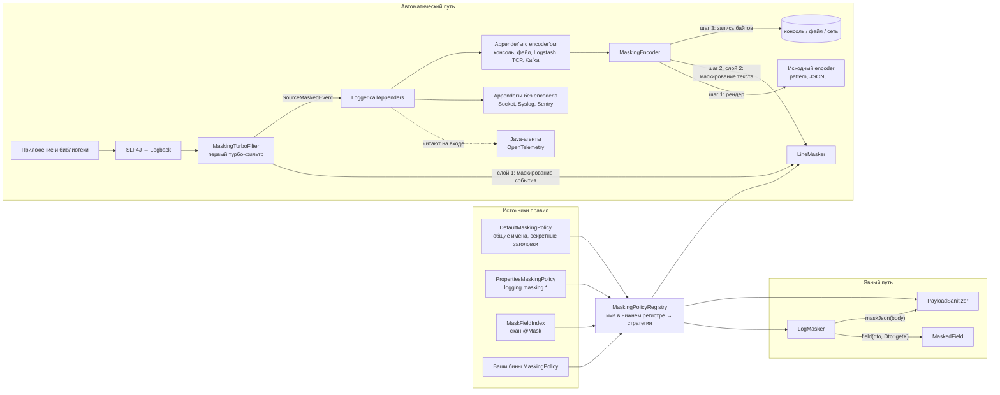
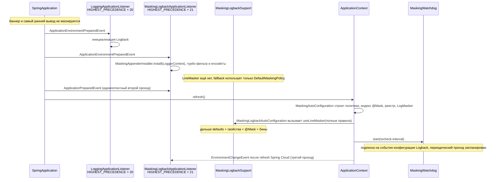
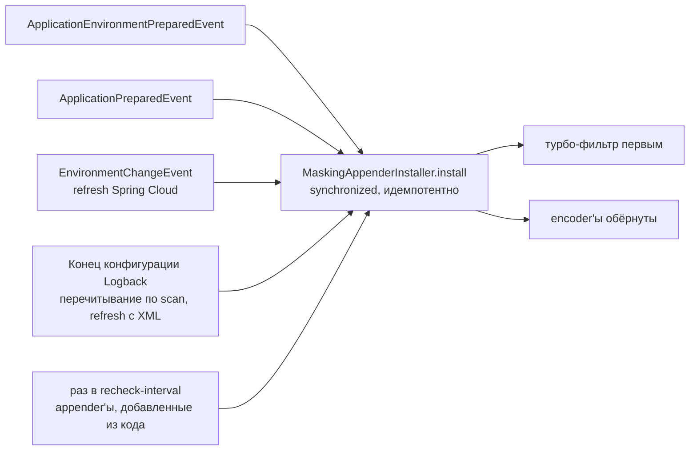
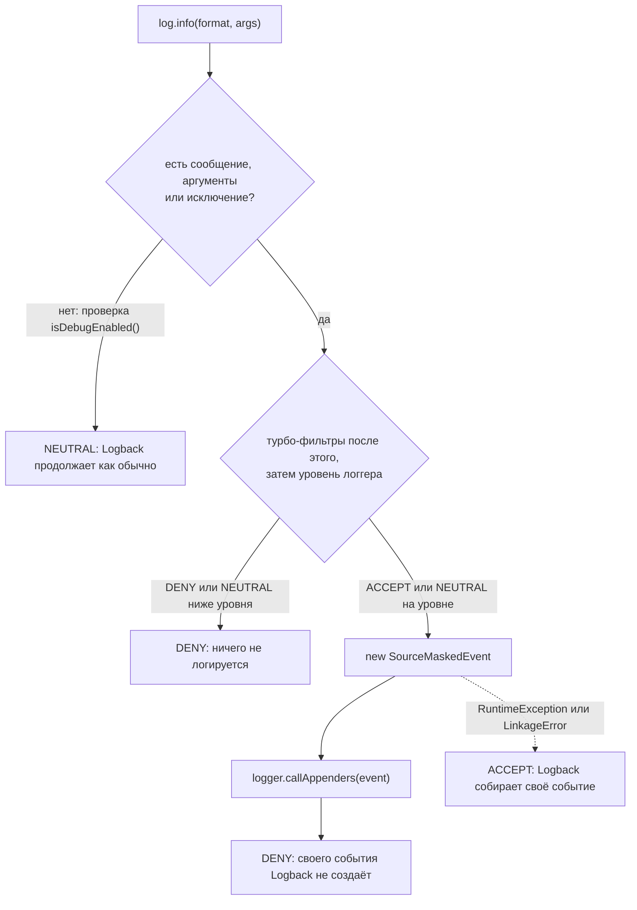
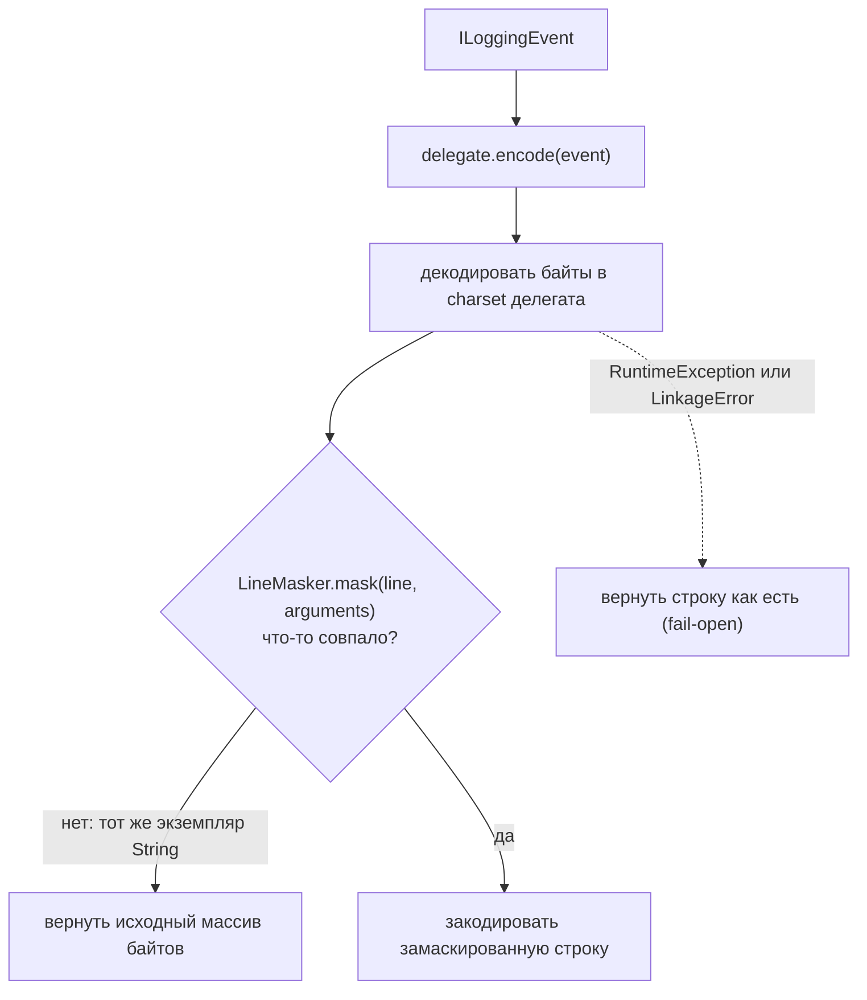
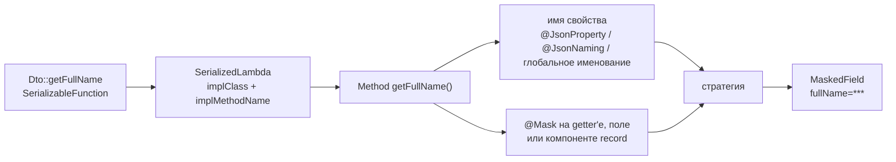

# Архитектура

[English](architecture.md) · Русский

Документ объясняет, как устроен стартер: откуда берутся правила, как событие лога маскируется до того,
как его прочтут appender'ы, и ещё раз в encoder'е, как работает явный API `LogMasker` и какие
компромиссы приняты сознательно. Поведение для пользователя описано в [README](../README.ru.md).

## Идея на одной картинке

Есть два пути, и у них общий набор правил:

- **Автоматический путь.** Два слоя внутри Logback. В источнике турбо-фильтр, который срабатывает
  раньше, чем Logback создаёт событие, собирает событие уже замаскированным: текст сообщения, MDC,
  key-value пары и сообщения исключений. Поэтому замаскированные данные получают все потребители
  события, включая appender'ы без encoder'а, Sentry и Java-агенты вроде OpenTelemetry. Вторым слоем у
  каждого appender'а с encoder'ом encoder оборачивается: обёртка даёт исходному encoder'у отрендерить
  строку, затем маскирует готовый текст по именам полей и только потом отдаёт байты на запись. Так
  ловится то, что encoder добавил сам, и события, прошедшие мимо фильтра. Через оба слоя проходят код
  приложения, код библиотек, MDC и stack trace.
- **Явный путь.** `LogMasker` закрывает то, чего автоматический путь не видит: безымянное значение в
  плейсхолдере или сырое JSON-тело, которое сейчас попадёт в лог или уйдёт куда-то ещё.

## Пакеты

| Пакет | Зависит от | Ответственность |
|---|---|---|
| `core` | JDK, Jackson, SLF4J API | Политики, реестр, сканер строк, стратегии, `LogMasker`, `@Mask`. Без Spring и без Logback. |
| `adapter.logback` | `core`, Logback | Турбо-фильтр и замаскированное событие, `MaskingEncoder`, обход appender'ов, watchdog, статический holder, общий для фильтра и encoder'ов. |
| `autoconfigure` | `core`, адаптер, Spring Boot | Свойства, связывание бинов, ранний listener старта, сканер `@Mask` по classpath. |

`core` намеренно не зависит от логгера: будущий адаптер Log4j2 ([roadmap F4](roadmap.md)) переиспользует
тот же сканер и реестр и добавляет только свою интеграцию с Log4j2.

| Класс | Роль |
|---|---|
| `MaskingPolicy` | Точка расширения. Отдаёт маскируемые имена, явные стратегии, секретные заголовки и контекстные имена. У всех методов есть реализация по умолчанию. |
| `DefaultMaskingPolicy` | Общие имена персональных данных и секретов плюс секретные заголовки. Отключается через `use-default-fields: false`. |
| `PropertiesMaskingPolicy` | Превращает `logging.masking.*` в `MaskingPolicy`, разворачивая группы `field-strategies`. |
| `MaskFieldIndex` | Имена, собранные из `@Mask(scope = ALL)`. Сам является `MaskingPolicy`. |
| `MaskingPolicyRegistry` | Сливает все политики в один неизменяемый lookup, включая поиск по подстроке без аллокаций. |
| `LineMasker` | Однопроходный сканер отрендеренного текста смешанного формата, плюс `maskValue` для значения, имя которого известно отдельно (MDC, key-value пары). |
| `MaskingFunctions` | Реализации `FULL`, `LAST4`, `HASH` и проверка, не имеет ли значение уже форму стратегии. |
| `MaskingTurboFilter` | Турбо-фильтр, который держится первым в цепочке. Собирает замаскированное событие, сам отдаёт его appender'ам и отвечает `DENY`. |
| `SourceMaskedEvent` | `LoggingEvent` из Logback, accessor'ы которого возвращают замаскированные сообщение, MDC, key-value пары и исключение. Массива аргументов нет; место вызова событие вычисляет само. |
| `MaskedThrowableProxy`, `MaskedThrowable` | Исключение события с замаскированными сообщениями по всей цепочке cause и suppressed и копия `Throwable` для потребителей, которые достают его сами. |
| `MaskingEncoder` | Обёртка Logback encoder'а вокруг исходного encoder'а: вторая линия за источником. |
| `MaskingAppenderInstaller` | Ставит турбо-фильтр первым, обходит логгеры и вложенные appender'ы, оборачивает encoder'ы внутри и вне `OutputStreamAppender`, сообщает о непокрытых appender'ах. |
| `MaskingWatchdog` | Повторно запускает установку, когда Logback заканчивает конфигурацию, и при периодической проверке. |
| `MaskingLogbackSupport` | Статический holder текущего `LineMasker` с fallback'ом только на defaults и политикой сбоя для каждого слоя. |
| `MaskingLogbackApplicationListener` | Ставит маскирование сразу после того, как Spring Boot инициализировал Logback, и повторно после refresh Spring Cloud. |
| `LogMasker`, `MaskedField` | Явный API для безымянных значений и JSON-тел. |
| `MethodReferenceResolver`, `MemberNames` | Превращают `Dto::getFullName` в имя поля и стратегию с учётом именования Jackson. |
| `PayloadSanitizer` | Маскирование JSON по дереву, с лимитом размера и контекстными правилами. |
| `MaskFieldIndexScanner` | Находит `@Mask` в пакетах приложения, не загружая посторонние классы. |

## Правила: из четырёх источников в один lookup

`MaskingPolicyRegistry` строится один раз и больше не меняется. Политики приходят в таком порядке:
`DefaultMaskingPolicy` (если включена), затем все бины `MaskingPolicy` в порядке Spring.
`PropertiesMaskingPolicy` и `MaskFieldIndex` — обычные бины этого типа.

Слияние идёт в два этапа, чтобы конфигурация могла ослабить имя из defaults, не удаляя его:

1. Каждое имя из `maskedFields()` каждой политики записывается с `FULL`.
2. Каждая запись из `fieldStrategies()` перекрывает этап 1. Если две политики задают одному имени разные
   явные стратегии, побеждает более строгая: `FULL > HASH > LAST4`. Порядок бинов не влияет.

Секретные заголовки хранятся отдельным множеством и всегда маскируются `FULL`: стратегия поля не может
сделать заголовок частично видимым. Все имена приводятся к нижнему регистру через `Locale.ROOT`.

Для горячего пути реестр строит две небольшие хеш-таблицы с открытой адресацией (`NameTable`): одну для
всех имён и заголовков, вторую только для заголовков. Поиск идёт прямо по `line[start, end)`, символы
приводятся к нижнему регистру на лету, поэтому сканирование строки не создаёт подстроку и её копию в
нижнем регистре для каждого кандидата в ключи. Таблицы заполнены не больше чем наполовину, размер
фиксируется на старте.

`contextualMaskedFields(siblings)` вычисляется для каждого JSON-объекта, потому что ответ зависит от
того, какие ещё поля в нём есть. Используется только в `PayloadSanitizer`.

## Старт: когда маскирование начинает работать

Logback создаётся задолго до того, как появляются Spring-контекст и его бины. Поэтому стартер работает
в две фазы.

- Listener регистрируется через `META-INF/spring.factories`, а не как бин: он должен сработать до
  появления контекста. Его порядок ровно на шаг позже `LoggingApplicationListener` из Boot: раньше
  appender'ов ещё нет, позже часть стартовых строк успела бы пройти без обёртки.
- Каждый проход ставит оба слоя: турбо-фильтр в начало цепочки и обёртки encoder'ов (см.
  [Установка](#установка)).
- Второй проход на `ApplicationPreparedEvent` нужен на случай повторной инициализации логирования
  (например, когда профиль меняет конфигурацию). Установка идемпотентна: уже обёрнутые encoder'ы
  учитываются, но не оборачиваются повторно, а фильтр, который уже стоит первым, остаётся на месте.
- Listener читает `logging.masking.enabled` и `logging.masking.mode` прямо из `Environment`.
  Неизвестный mode здесь трактуется как `encoder`, чтобы опечатка не выключила маскирование молча ещё
  до старта контекста. Позже binding свойств отвергает то же значение и роняет старт. Оба значения
  решаются один раз, на старте; refresh их не пересматривает (см. ниже).
- `MaskingLogbackAutoConfiguration` публикует `LineMasker` из контекста через `InitializingBean`.
  Поле holder'а `volatile`, поэтому фильтр и encoder'ы в других потоках переключаются без блокировок.

### Как маскирование остаётся на месте

Logback может пересобраться во время работы приложения: refresh Spring Cloud с bootstrap поднимает
временный контекст, который перенастраивает Logback, `scan="true"` перечитывает XML, ошибка разбора
откатывает к запасной конфигурации, а код или библиотека могут добавить appender. В пересобранном
контексте новые appender'ы со своими encoder'ами, а после `reset()` — ни одного турбо-фильтра.
Маскирование пропало бы до рестарта, поэтому установка запускается повторно по нескольким триггерам:

- **Третий проход listener'а.** `MaskingLogbackApplicationListener` обрабатывает и
  `EnvironmentChangeEvent` из Spring Cloud; событие распознаётся по имени класса, чтобы стартеру не
  был нужен spring-cloud-context. Проход выполняется, только если в контексте, опубликовавшем событие,
  есть `MaskingLogbackAutoConfiguration`, то есть маскирование было включено на старте; `enabled`
  заново не читается. Решение во время работы было бы неверным в обе стороны: маскирование, включённое
  через refresh, работало бы по fallback-списку, потому что бины слоя так и не были созданы, а
  выключенное через refresh пропало бы, только если Logback случайно пересоберётся. С bootstrap
  событие доходит и до listener'а родительского bootstrap-контекста; этот проход находит всё на месте
  и молчит.
- **Временные контексты refresh ничего не решают.** Listener попадает в них через
  `spring.factories`, но в их окружении нет `application.yml`, так что маскирование, выключенное там,
  включилось бы. Их узнают по источнику свойств `refreshArgs` — тому же признаку, по которому Spring
  Cloud отключает в них `LoggingApplicationListener`.
- **События конфигурации.** `MaskingWatchdog` — бин `MaskingLogbackAutoConfiguration`, он закрывается
  вместе с контекстом. Watchdog подписан на события конфигурации Logback: каждая XML-конфигурация
  (перечитывание по `scan`, запасная конфигурация после ошибки разбора, пересборка
  `logback-spring.xml` при refresh) заканчивается событием конца конфигурации, и watchdog сразу
  запускает установку в потоке конфигурации. Listener'ы событий переживают `reset()`, поэтому одной
  подписки достаточно; Logback без этих событий остаётся только с периодическим проходом. Пока Spring
  пересобирает Logback при refresh, он глушит весь лог, и строка, написанная из события, потерялась
  бы: watchdog запоминает, сколько обернул, а третий проход listener'а об этом сообщает.
- **Периодический проход.** Программная конфигурация без XML и appender'ы, добавленные из кода,
  событий не порождают. Поэтому watchdog повторяет проход раз в `logging.masking.recheck-interval`
  (по умолчанию `10s`; `0` выключает проверку, иначе не меньше `1s`: проход берёт блокировку
  установщика, и чаще он только мешает). Проход без изменений стоит десятки микросекунд на сотни
  логгеров и ничего не пишет; проход, которому пришлось что-то обернуть или вернуть фильтр, пишет WARN:
  значит, был пробел в маскировании. О проходе, который падает каждый раз, и об источнике, который не
  удаётся вернуть, сообщается один раз.

Итоговые окна покрытия описаны в ограничениях README: до инициализации Logback — ничего, до готовности
контекста — только общие defaults, после — полные правила. После старта: строки других потоков в
миллисекунды между пересборкой Logback при refresh и третьим проходом, если Logback собран без XML, а
у appender'а, добавленного из кода, — то, что его encoder добавляет сам, до ближайшего периодического
прохода. Каждый случай со статусом ведётся в [known gaps](known-gaps.md) (на английском).

## Автоматический путь: источник и encoder

### Установка

`MaskingAppenderInstaller.install(LoggerContext)` ставит оба слоя за один проход и возвращает
`Report`. Метод `synchronized`: проходы идут из разных потоков (старт, refresh, события конфигурации,
периодическая проверка), а проверка «уже обёрнут» и замена encoder'а не атомарны.

Первым ставится источник. `MaskingTurboFilter` добавляется в начало цепочки турбо-фильтров контекста
или возвращается в начало, если его опередил другой фильтр. Перестановка — одна сортировка
copy-on-write списка, поэтому другие потоки никогда не видят цепочку без фильтра. Фильтр ставится в
том же проходе, что и encoder'ы, потому что `LoggerContext.reset()` удаляет турбо-фильтры вместе с
appender'ами.

Затем установщик проходит по всем логгерам в `LoggerContext` и по всем подключённым appender'ам.
Составные appender'ы (`AppenderAttachable`, например `AsyncAppender`) обходятся рекурсивно.
Identity-множество не даёт посетить общий appender дважды.

- `OutputStreamAppender` с encoder'ом (консоль, файл, rolling file): encoder заменяется на
  `MaskingEncoder(original)`.
- Другой appender с encoder'ом (`LogstashTcpSocketAppender`, `KafkaAppender`, собственные сетевые
  appender'ы и appender'ы брокеров сообщений): encoder находится через публичный
  `setEncoder(Encoder)` и `getEncoder()`, а без getter'а — через поле `encoder`, и оборачивается так
  же. Результат поиска кешируется на класс; списка известных классов appender'ов у стартера нет.
- Составной appender со своим encoder'ом: `KafkaAppender` пишет основной поток сам и передаёт
  вложенным appender'ам только то, что не удалось отправить, поэтому оборачиваются и его encoder, и
  вложенные. Составной appender без encoder'а (`AsyncAppender`) только пересылает события и покрыт
  вложенными.
- Appender без encoder'а (`SocketAppender`, `SyslogAppender`, `SMTPAppender`, собственные): помечается
  как неподдерживаемый. Он получает событие, замаскированное в источнике, но то, что он добавляет сам,
  не маскируется. Listener называет эти классы в INFO на старте, а если источник поставить не удалось —
  в WARN.

`Report` содержит число обёрнутых и уже обёрнутых encoder'ов, неподдерживаемые классы и состояние
`Source`: `ATTACHED` (этот проход поставил фильтр или вернул его в начало), `PRESENT` (фильтр уже стоял
первым) или `FAILED` (поставить не удалось; маскируется только вывод encoder'ов). Проходы после
refresh и в watchdog пишут в лог, только если что-то изменилось (`wrapped > 0` или `ATTACHED`) или
источник не встал.

### Маскирование в источнике

`MaskingTurboFilter` срабатывает раньше, чем Logback создаёт событие, на любом пути, который доходит до
`Logger`: `log.info(...)`, мосты JCL, JUL и Log4j и, начиная с Logback 1.5.25, fluent API SLF4J.
Фильтр сам собирает событие, отдаёт его в `logger.callAppenders` и отвечает `DENY`, поэтому исходное,
незамаскированное событие Logback не создаёт.

- `DENY` обрывает цепочку, поэтому её остаток фильтр применяет сам, ровно как Logback: опрашивает
  турбо-фильтры за собой по порядку и берёт первый ответ, отличный от `NEUTRAL`. `DENY` — события нет,
  `ACCEPT` — событие пишется на любом уровне, `NEUTRAL` — решает эффективный уровень логгера. Каждый
  фильтр опрашивается один раз за вызов, поэтому счётчики вроде `DuplicateMessageFilter` не
  сбиваются. Это работает, только пока фильтр стоит первым: фильтр перед ним мог бы пропустить
  незамаскированное событие, поэтому каждый проход установщика возвращает его в начало. Когда он
  единственный турбо-фильтр, а это обычный случай, проверка сводится к сравнению размера без аллокации
  лямбды: `decide` вызывается на каждый вызов логгера, включая выключенные уровни.
- Для fluent API Logback уже проверил уровень и смотрит только на `DENY`; фильтр делает так же.
- Проверка уровня вроде `isDebugEnabled()` приходит без сообщения, аргументов и исключения и события
  не создаёт, поэтому фильтр отвечает `NEUTRAL`. `log.error(null)` выглядит точно так же и тоже
  остаётся Logback; такое событие проходит мимо источника, и маскирует его только encoder.

`SourceMaskedEvent` наследует `LoggingEvent` из Logback. Потребители читают событие по-разному (encoder
рендерит строку, `SocketAppender` сериализует поля, Sentry берёт аргументы и MDC по отдельности, агент
OpenTelemetry снимает событие на входе в `callAppenders`), но все идут через эти accessor'ы:

| Accessor | Что возвращает |
|---|---|
| `getFormattedMessage()`, `getMessage()` | Готовое сообщение после `LineMasker.mask(text, arguments)`. Шаблон наружу не отдаётся. |
| `getArgumentArray()` | `null`. Аргументы не замаскированы, и потребитель, который сам форматирует шаблон, напечатал бы их. |
| `getMDCPropertyMap()`, `getMdc()` | MDC, каждое значение которого прошло через `LineMasker.maskValue(key, value)`. |
| `getKeyValuePairs()` | Key-value пары fluent API, замаскированные так же. Значение, которое маскировать не пришлось, сохраняет свой тип. |
| `getThrowableProxy()` | `MaskedThrowableProxy` с замаскированными сообщениями по цепочке `cause` и `suppressed`. |
| `getCallerData()` | Кадры места вызова, которые событие вычисляет само. |

- Маски вычисляются лениво и кешируются, как `LoggingEvent` делает со своими полями: событие, которое
  ни один appender не рендерит, за них не платит. MDC и список key-value пар, в которых маскировать
  нечего, возвращаются тем же экземпляром.
- Исходные аргументы остаются внутри события только для обёртки encoder'а: по ним она узнаёт вывод
  `LogMasker.field()` (см. [Уже замаскированные аргументы](#уже-замаскированные-аргументы)).
- Сообщение маскируется до того, как его экранирует encoder. Поэтому JSON-тело, записанное через
  JSON-encoder, маскируется, пока его кавычки ещё не экранированы, а значение MDC, напечатанное через
  `%X{key}` и стоящее в строке без имени, маскируется по своему ключу.
- `MaskedThrowableProxy` сохраняет имя класса и кадры оригинала и маскирует сообщение каждого
  исключения в цепочке. Он наследует `ThrowableProxy`, а не только реализует `IThrowableProxy`: Sentry
  приводит исключение события к этому классу без проверки, OpenTelemetry и `StackTracePrinter` из
  Boot — с проверкой. Потребители, которые достают сам `Throwable`, получают `MaskedThrowable`,
  создаваемый по запросу: замаскированные сообщения, исходные кадры и `toString()`, в первой строке
  которого остаётся настоящее имя класса. Цепочка, в которой маскировать нечего, остаётся исходной, и
  её настоящий тип виден; чистая причина замаскированного исключения остаётся собой; цепочка с циклом
  копируется целиком, чтобы из копии нельзя было добраться до оригинала.
- Logback ищет место вызова по имени класса логгера и теперь нашёл бы фильтр. Событие начинает с
  кадра `Logger.callAppenders` и пропускает кадры логирования (Logback, сам фильтр, SLF4J, API JCL,
  Log4j, JBoss Logging и JUL, настроенные `frameworkPackages`), а затем кадры граничного класса: того,
  что передал fluent API, или, для обёртки над `LocationAwareLogger`, класса, вызвавшего `Logger.log`.

### Кодирование строки

`MaskingEncoder` — вторая линия. Он ловит то, что encoder добавляет к событию сам (например, поля
маркеров Logstash), события, прошедшие мимо фильтра (fluent API SLF4J в Logback до 1.5.25, прямой
`callAppenders` или `doAppend`, `log.error(null)`), и события, которые Logback собрал сам, потому что
источник не смог собрать своё.

- Обёртка маскирует **отрендеренный** вывод. Всё, что layout положил в строку — сообщение, аргументы,
  MDC, маркеры, stack trace, — видно сканеру. От сторонних библиотек ничего не требуется.
- Для события, замаскированного в источнике, отрендеренная строка обычно уже замаскирована. Повторный
  проход находит только значения, у которых уже есть форма их стратегии, поэтому сканер возвращает тот
  же `String`, и encoder пишет исходные байты.
- Charset берётся у делегата: `LayoutWrappingEncoder.getCharset()` или строка из `getEncoding()`, как
  его объявляют encoder'ы Logstash, которые пишут UTF-8 независимо от `file.encoding`. Другой charset
  мог бы испортить не-ASCII вывод.
- Если ничего не совпало, `LineMasker` возвращает тот же экземпляр `String`. Encoder замечает это
  проверкой по ссылке и возвращает исходные байты без перекодирования. В большинстве строк маскировать
  нечего, так что это основной случай.
- Байты header и footer, `start()` и `stop()` делегируются.

### Сканер строк

`LineMasker` проходит строку один раз слева направо. `StringBuilder` создаётся только при первом
совпадении, до этого символы лишь читаются. Сканер реагирует на три триггера:

| Триггер | Какие имена ищутся | Где заканчивается значение |
|---|---|---|
| `"key":` (ключ в кавычках и двоеточие) | все маскируемые имена и секретные заголовки | конец JSON-значения: строка, сбалансированные `{…}`/`[…]` или скаляр до `,` `}` `]`, пробела или перевода строки |
| `key=` | все маскируемые имена и секретные заголовки | значение в кавычках, сбалансированные `(…)`/`[…]`/`{…}` или текст до `&`, перевода строки, закрывающей скобки, которую значение не открывало, или запятой, на которой значение заканчивается (см. ниже) |
| `Key:` (голое двоеточие) | **только секретные заголовки** | так же, как для `key=` |

Что из этого следует:

- Ключ читается назад от разделителя: буквы, цифры, `_`, `$` и `-` (поэтому `X-Auth-Token` — одно
  имя). Точка разделяет, так что `user.email=` совпадает с `email`. Пробелы перед `=` допустимы. Ключи
  длиннее 64 символов игнорируются.
- Пробелы входят в обычное значение: `fullName=John Smith` маскируется целиком.
- Запятая заканчивает обычное значение, если за ней идёт следующее поле или если пара стоит в тексте
  сообщения. Внутри скобок дампа (`Dto(...)`, Map `{...}`) поля идут парами `name=`, поэтому запятая,
  за которой нет `name=`, относится к значению: в
  `{phone=5550100, address=12 Main St, Springfield, requestId=42}` адрес маскируется до
  `, requestId=`. В тексте сообщения запятая всегда заканчивает значение, поэтому в
  `fullName=Smith, John` останется видно `John`; иначе `email=..., processing took 5 ms`
  замаскировалось бы до конца строки вместе с диагностикой. Это цена маскирования произвольного текста
  без грамматики; в README это описано.
- Пара стоит внутри дампа, если перед ней в строке или во фрагменте в кавычках есть незакрытая
  открывающая скобка: `{`, `[` или `(` сразу после имени. Сбалансированные скобки префикса pattern'а
  (`[main]`, `[traceId,spanId]`) не в счёт, как и `(` в тексте: в
  `Customer not found (email=..., reason: ...)` запятая остаётся границей, и причина остаётся видна.
  Следующее поле распознаётся и без пробела после запятой, и с именем через точку (`,user.email =`).
  После секретного заголовка с двоеточием следующее поле начинает и `, Content-Type:`; для пары с `=`
  двоеточие поле не начинает.
- Скобки внутри значения проходятся целиком: `address=Main St (Building 1, Unit 2), id=7` не
  заканчивается на первой `)`, а вложенный объект сразу после имени, `AddressDto(city=..., street=...)`,
  маскируется вместе со своими полями. Текстовая скобка — открывающая `(`, которая не следует за
  именем (`:(`, `(by proxy`), — может так и не закрыться и тогда забрала бы закрывающую скобку дампа
  вместе с соседними полями. Поэтому `, name=` внутри текстовой скобки заканчивает значение, а
  значение, которое дошло до конца строки с незакрытой скобкой или с текстовой скобкой внутри дампа,
  сканируется заново без учёта скобок. Закрывающая `)`, которую значение не открывало, по-прежнему его
  заканчивает: в `Dto(password=1) no address, 2) no phone, id=7)` маскируется только `1`, потому что
  по строке не видно, чья это скобка. Это известное ограничение.
- Голое `Name: value` распознаётся только для секретных заголовков. Обычная метка вроде `Comment:`
  часто открывает свободный текст без надёжной границы, и её маскирование могло бы съесть остаток
  сообщения.
- `null` сохраняется: он говорит, что значения нет, — это полезно и не чувствительно.
- Структурные encoder'ы кладут всё сообщение в одну JSON-строку. Поэтому сканер продолжает работать
  внутри фрагментов в кавычках, которые не являются ключами, а закрывающая кавычка объемлющего
  фрагмента ограничивает конец обычного значения. Замена никогда не съедает закрывающую кавычку и
  остаток JSON-записи.
- `FULL` вставляет константу `***`, не читая значение. `LAST4` и `HASH` сначала снимают обрамляющие
  кавычки, поэтому `'1234 5678'` и `"1234 5678"` дают одинаковый результат. В JSON замена всегда
  пишется строкой: `"***"`.
- Значение, которое уже имеет форму своей стратегии, остаётся как есть: `***` для `FULL`, `***` и не
  больше четырёх символов после него для `LAST4`, `#` и восемь hex-символов в нижнем регистре для
  `HASH`; обрамляющие кавычки при проверке снимаются. Текст сканируется дважды — в источнике и ещё раз
  в encoder'е. Для `HASH` проверка нужна ради корректности: хеш от хеша сломал бы корреляцию со
  значениями, захешированными один раз, а вывод `maskJson` тоже приходит уже захешированным. Для
  остальных стратегий это быстрый путь: повторно просканированная замаскированная строка не меняется и
  возвращается тем же экземпляром. Поэтому сырое значение ровно такой формы не маскируется, но и
  ничего не раскрывает.

`maskValue(name, value)` обрабатывает значение, имя которого известно отдельно от текста: запись MDC
или key-value пару fluent API. Если имя — маскируемое поле или секретный заголовок, всё значение
маскируется его стратегией; заголовки лежат в одной таблице с `FULL`, так что это один поиск на ключ.
Иначе значение сканируется как строка, потому что в MDC бывают целые дампы. Уже замаскированное
значение и значение, в котором маскировать нечего, возвращаются тем же экземпляром.

### Уже замаскированные аргументы

Источник передаёт аргументы вызова в `LineMasker.mask(text, arguments)`, и `MaskingEncoder` делает так
же: для события, замаскированного в источнике, он берёт их из приватной копии события, потому что
`getArgumentArray()` возвращает `null`. Когда сканер доходит до `name=`, а дальше в тексте стоит ровно
отрендеренный `MaskedField`-аргумент с этим именем, пара копируется как есть, и сканирование
продолжается после неё. Без этого сканер замаскировал бы пару повторно: захешировал бы хеш, заменил бы
стратегию `@Mask` на глобальную и — поскольку пробелы входят в обычное значение — съел бы текст
сообщения после плейсхолдера.

Доверие есть только экземплярам `MaskedField`, но не строкам с тем же текстом. Отрендеренная пара
содержит лишь имя и уже замаскированное значение, поэтому её сохранение ничего не раскрывает. Буква или
цифра сразу после неё означает, что текст только начинается как поле (более длинное сырое значение), и
он маскируется как обычно. Секретный заголовок сохраняется, только если поле замаскировано полностью:
`@Mask` с частичной стратегией не ослабляет заголовок. Строки без аргументов `MaskedField` идут
прежним путём.

### Поведение при сбое

Слои ведут себя при сбое по-разному, потому что ещё один слой перед собой есть только у encoder'а.

| Где | Что происходит | Как сообщается |
|---|---|---|
| Маскировщик в источнике (`MaskingLogbackSupport.maskMessage`, `maskValue`) | Сообщение, значение MDC, key-value пара или сообщение исключения заменяется на `[message suppressed: log masking failed]` | один WARN на процесс |
| Сборка `SourceMaskedEvent` | Фильтр отвечает `ACCEPT`, и Logback собирает своё, незамаскированное событие; маскируется только вывод encoder'ов | один WARN на процесс |
| Установка фильтра | `Source.FAILED`; маскируется только вывод encoder'ов | WARN от listener'а или watchdog |
| Маскировщик в encoder'е (`MaskingLogbackSupport.maskLine`) | Строка пишется без изменений | не сообщается |

- В источнике событие читают все потребители сразу, включая appender'ы без encoder'а и Java-агенты, и
  за ними ничего нет, поэтому открытым оно уйти не должно. Замена только текста сохраняет саму запись:
  уровень, логгер, время и кадры stack trace. WARN идёт через тот же логгер и снова маскируется; флаг
  ставится до записи, поэтому повторный сбой на этой строке не зацикливается.
- Сбой сборки события означает, что Logback несовместим с фильтром, а не что сломан маскировщик.
  Ответ — `ACCEPT`, а не `NEUTRAL`: остальные фильтры и уровень уже приняли решение, а на `NEUTRAL`
  Logback опросил бы их снова, и фильтры с состоянием считали бы каждую строку дважды. Сам WARN тоже
  проходит через фильтр; если сборка снова падает, флаг уже стоит, и строка уходит в Logback без
  повторного сообщения.
- В encoder'е `maskLine` ловит `RuntimeException` и `LinkageError` и возвращает исходную строку. Сбой
  не логируется: запись лога изнутри encoder'а ушла бы рекурсией в тот же appender. Это осознанный
  выбор доступности в ущерб секретности: ошибка в сканере не должна останавливать логирование
  приложения. События, замаскированные в источнике, доходят до encoder'а уже замаскированными, поэтому
  сбой здесь раскрывает то, что encoder добавил сам, и события, прошедшие мимо фильтра. В README это
  указано как ограничение.

## Явный путь: `LogMasker`

### `field(dto, Dto::getFullName)`

1. `SerializableFunction` заставляет компилятор сгенерировать сериализуемую лямбду. Resolver получает
   её `SerializedLambda`, прогоняя лямбду через `ObjectOutputStream`, который пишет в null-поток и
   перехватывает объект в `replaceObject`. Фактически ничего не сериализуется; так не нужен
   рефлективный доступ к приватному `writeReplace` скрытого класса, который может не сработать в
   именованных модулях.
2. Принимаются только несвязанные ссылки на методы экземпляра. Тела лямбд, связанные ссылки
   (`dto::getFullName`) и статические методы отклоняются с `IllegalArgumentException`: имя поля из
   них не вывести.
3. Метод ищется в классе реализации (сначала `getMethod`, чтобы найти унаследованные public-методы и
   default-методы интерфейсов). `getX`/`isX` превращаются в `x`; accessor'ы record сохраняют имя.
4. Имя — значение `@JsonProperty`, если оно есть, иначе Java-имя, преобразованное `@JsonNaming` класса
   или глобальной стратегией именования `ObjectMapper`.
5. Стратегия: побеждает `@Mask` на getter'е, поле или компоненте record, включая `TYPED`-члены,
   которых нет в глобальном индексе. Иначе реестр опрашивается по каждому варианту написания. Имя,
   неизвестное всем политикам, маскируется `FULL`, и один раз пишется предупреждение.
6. Результат кешируется на класс лямбды в `ClassValue`, то есть фактически один раз на место вызова.

`field("name", value)` пропускает шаги 1–4 и сразу спрашивает реестр; неизвестные имена получают `FULL`
и одно предупреждение на имя (не больше 1000 разных имён).

`MaskedField` — объект, который передаётся в SLF4J. Он лениво рендерит `name=masked` в `toString()` и
кеширует результат, поэтому при выключенном уровне лога ничего не вычисляется.

### `maskJson(body)`

`PayloadSanitizer` работает с целыми JSON-документами, обычно телами запросов и ответов:

1. Тела больше `max-body-size` (в байтах UTF-8) заменяются коротким уведомлением без парсинга.
2. Тело разбирается в дерево Jackson приватной копией `ObjectMapper` приложения.
3. Для каждого объекта собираются имена соседних полей, у реестра запрашиваются контекстные имена,
   затем совпавшие значения заменяются через `MaskingFunctions.apply(...)`, а в остальные значения
   обход спускается рекурсивно.
4. Некорректный JSON превращается в `body omitted`, а не утекает частично разобранным.

Этот путь знает структуру документа, поэтому только здесь можно применять контекстные правила (поле,
чувствительное лишь рядом с определёнными соседями).

## Индекс `@Mask`

Encoder видит текст, а не объекты, поэтому аннотации нужно заранее превратить в имена.

1. Пакеты: `logging.masking.scan-packages`, а если список пуст — пакеты автоконфигурации
   `@SpringBootApplication`.
2. Каждый ресурс `.class` в этих пакетах читается как байты, и в нём ищется дескриптор аннотации
   `Lio/github/laipan009/logmasking/core/Mask;`. Классы без него не загружаются. Это держит старт
   дешёвым в больших приложениях, где аннотированы лишь несколько DTO.
3. Подходящие классы загружаются и инспектируются: компоненты record, нестатические поля и методы
   экземпляра без аргументов.
4. Для `@Mask(scope = ALL)` индекс сохраняет Java-имя, имя из `@JsonProperty` и имя после стратегии
   именования — все с одной стратегией. `TYPED`-члены пропускаются.
5. Скан пишет одну итоговую строку: число классов, время и первые 20 имён.

Поскольку совпадение идёт по имени, `@Mask String comment` в одном DTO маскирует `comment=` в любой
строке лога. `TYPED` существует как раз для случаев, когда это слишком широко.

## Точки расширения

| Задача | Механизм |
|---|---|
| Фиксированный список дополнительных имён, заголовков или стратегий | свойства `logging.masking.*` |
| Имена, принадлежащие DTO | `@Mask` |
| Вычисляемые имена, общие правила компании, контекстные JSON-правила | бин `MaskingPolicy` (один или несколько) |
| Полностью заменить компонент | все бины в `MaskingAutoConfiguration` и `LineMasker` объявлены с `@ConditionalOnMissingBean` |
| Выключить автоматическое маскирование, оставив `LogMasker` | `logging.masking.mode: off` |
| Выключить всё | `logging.masking.enabled: false` |

Правила конкретной организации должны жить в приложении-потребителе или приватной companion-библиотеке,
а не в форке этого движка. Рекомендуемая схема описана в [releasing.md](releasing.md).

## Проектные решения

**Маскировать в источнике.** Первая версия маскировала только в encoder'е, но encoder — лишь один из
читателей события. Java-агент OpenTelemetry читает его на входе в `callAppenders`, до всех
appender'ов; appender'ы без encoder'а и Sentry сами берут его поля; JSON-encoder экранирует JSON-тело в
сообщении раньше, чем его увидит сканер; `%X{key}` печатает значение MDC без имени. После рендера
ничего из этого не исправить. Переписать готовый `ILoggingEvent` до appender'ов в общем виде нельзя,
но турбо-фильтр срабатывает до появления события, на любом пути логирования, и не требует правки
конфигурации, поэтому стартер собирает событие замаскированным прямо там. Цена: фильтр должен
воспроизводить цепочку турбо-фильтров и проверку уровня и стоять первым, место вызова событие
вычисляет само, аргументов у него нет (`StructuredArguments` Logstash остаются в тексте сообщения,
Sentry группирует по тексту, а не по шаблону), и каждое сообщение сканируется дважды.

**Оставить обёртку encoder'а второй линией.** Собственный конвертер `%msg` потребовал бы правки
каждого pattern'а и пропустил бы MDC и stack trace. Обёртка encoder'а видит итоговый текст любого
layout'а, не требует правки `logback-spring.xml` и оставляет форматирование полностью исходному
encoder'у. За источником она ловит то, что encoder'ы добавляют сами (поля маркеров, собственные
JSON-провайдеры), и события, прошедшие мимо фильтра. На тексте, уже замаскированном в источнике, она
стоит одного прохода сканера и проверки по ссылке: повторный проход возвращает тот же `String`, и
пишутся исходные байты.

**Совпадение по имени, а не по содержимому.** Распознавать произвольные персональные данные по форме
(номера карт, форматы телефонов, ФИО) ненадёжно и дорого, а ложные срабатывания уничтожают
диагностическую ценность логов. Имена явны, тестируемы и дёшевы в поиске. Цена — безымянное значение
для сканера невидимо; этот разрыв закрывает `LogMasker.field`.

**Один проход, без регулярных выражений.** Через сканер проходит каждое сообщение — в источнике и ещё
раз в encoder'е. Рукописный сканер с таблицей имён без аллокаций сводит частый случай «ничего не
совпало» к чтению строки и проверке по ссылке. `LineMaskerAllocationTest`,
`MaskingSourcePerformanceTest` и остальные `perf`-тесты это измеряют.

**Статический holder между Logback и Spring.** Logback создаёт турбо-фильтр и encoder'ы вне Spring, а
работать они должны до появления контекста. Одно `volatile`-поле с ленивым fallback'ом на defaults —
минимальный мост, который позволяет и то и другое.

**Fail-open в encoder'е, подавление в источнике.** Потерять логи во время инцидента для большинства
сервисов хуже, чем редкая незамаскированная строка из-за бага, поэтому сбой никогда не выбрасывает
запись. В источнике событие уходит всем потребителям сразу, и за ними ничего нет, поэтому при сбое
текст заменяется заглушкой, а не пропускается как есть. В encoder'е событие обычно приходит уже
замаскированным, так что fail-open раскрывает только то, что добавил encoder, и события, прошедшие
мимо фильтра. Выбрасывать строку в encoder'е можно было бы за свойством; сейчас этого нет.

**Строгое разрешение конфликтов.** Когда источники расходятся в стратегии, результат не должен зависеть
от порядка бинов, а безопаснее тот ответ, который раскрывает меньше.

## Тестирование

| Уровень | Примеры | Что доказывает |
|---|---|---|
| Unit | `LineMaskerTest`, `DefaultMaskingPolicyTest`, `MaskingPolicyRegistryTest`, `MaskingFunctionsTest`, `PayloadSanitizerTest`, `LogMaskerTest` | Формы и границы сканера (запятые и скобки в дампах и в тексте), `maskValue`, уже замаскированный текст, правила слияния, стратегии, работа с JSON, ссылки на методы. |
| Маскирование в источнике | `MaskingTurboFilterTest`, `MaskedThrowableProxyTest` | Что получает каждый потребитель (appender'ы без encoder'а, `AsyncAppender`, JSON-encoder'ы, MDC, key-value пары, исключения), решения цепочки фильтров и уровня как в Logback, место вызова, фильтр остаётся первым, заглушка при сбое, копии исключений через Logback-маппер OpenTelemetry и appender Sentry. |
| Адаптер Logback | `MaskingEncoderTest`, `MaskingAppenderInstallerTest`, `MaskingWatchdogTest`, `MaskingLogbackSupportTest` | Обёртка, charset, включая `getEncoding()`, переиспользование байтов, encoder'ы вне `OutputStreamAppender` (`LogstashTcpSocketAppender`, составные со своим encoder'ом, поле `encoder`), неподдерживаемые appender'ы, повторная установка по событиям конфигурации и по расписанию, fallback, вывод `LogMasker` через настоящий encoder. |
| Автоконфигурация | `MaskingAutoConfigurationTest`, `MaskingLogbackAutoConfigurationTest`, `MaskingLogbackApplicationListenerTest`, `MaskFieldIndexScannerTest` | Условия, свойства, порядок listener'а и режимы, проходы после refresh и решение старта, проверка `recheck-interval`, скан аннотаций. |
| Интеграция | `LogPiiCanaryIT`, `LogMaskerFieldIT`, `MaskingAfterRefreshIT` | Настоящее Spring Boot-приложение. При HTTP-вызовах canary-значения не должны попасть ни в stdout, ни к потребителям без encoder'а, а соседний контекст остаётся читаемым. После refresh Spring Cloud, пересобравшего Logback, с XML и без него маскирование возвращается, а решение старта сохраняется. |
| Производительность | `LineMaskerAllocationTest`, `MaskJsonPerformanceTest`, `MaskingEncoderPerformanceTest`, `MaskingSourcePerformanceTest` (`./mvnw test -Pperf`) | Замеры аллокаций и пропускной способности, а также всего вызова логгера без маскирования, только с encoder'ом и с обоими слоями; исключены из обычной сборки, без машинно-зависимых порогов. |
