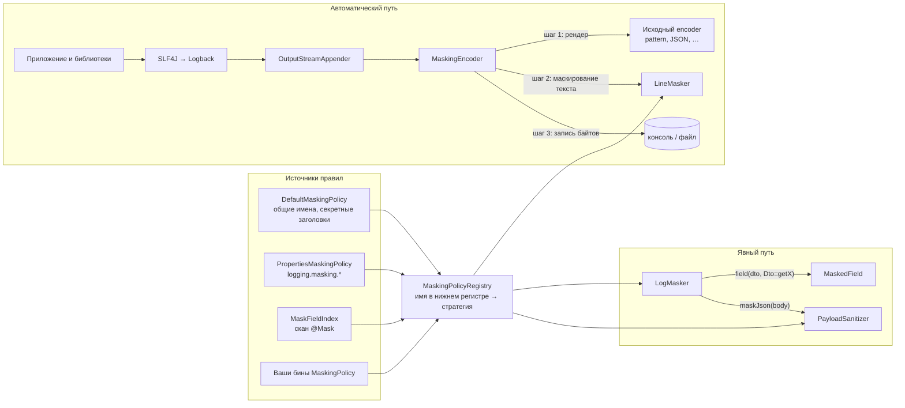
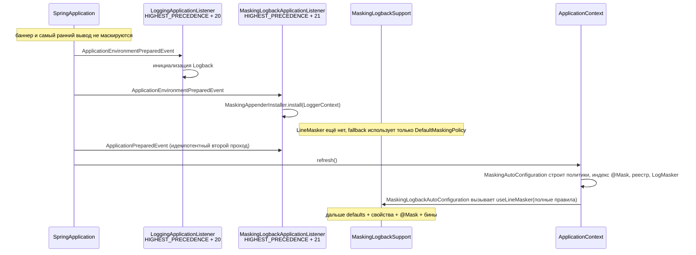
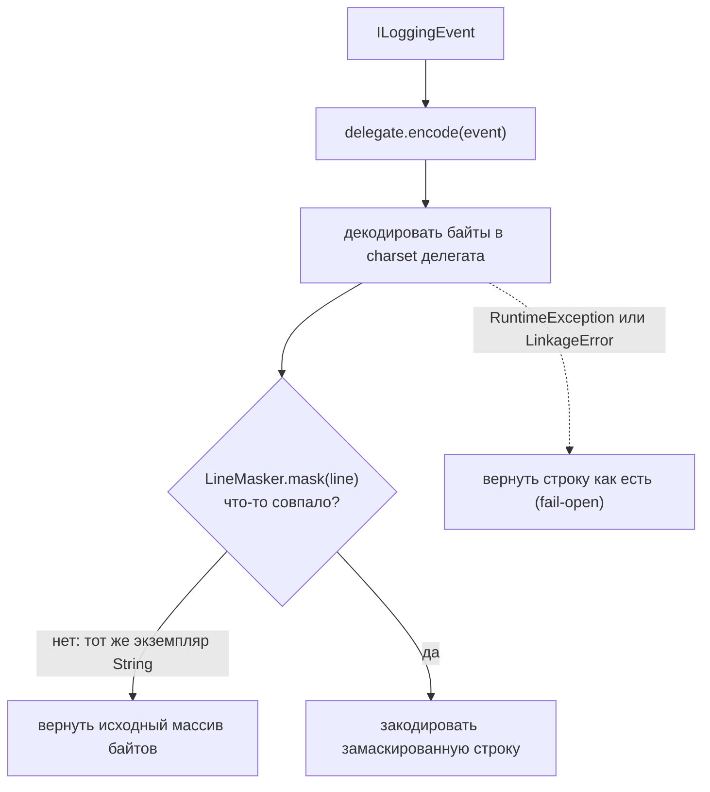
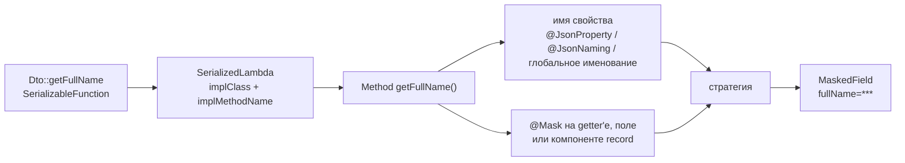

# Архитектура

[English](architecture.md) · Русский

Документ объясняет, как устроен стартер: откуда берутся правила, как строка лога маскируется по пути
к appender'у, как работает явный API `LogMasker` и какие компромиссы приняты сознательно. Поведение
для пользователя описано в [README](../README.ru.md).

## Идея на одной картинке

Есть два пути, и у них общий набор правил:

- **Автоматический путь.** У каждого поддерживаемого appender'а Logback encoder оборачивается.
  Обёртка даёт исходному encoder'у отрендерить строку, затем маскирует готовый текст по именам полей
  и только потом отдаёт байты на запись. Через неё проходят код приложения, код библиотек, MDC и
  stack trace.
- **Явный путь.** `LogMasker` закрывает то, чего автоматический путь не видит: безымянное значение в
  плейсхолдере или сырое JSON-тело, которое сейчас попадёт в лог или уйдёт куда-то ещё.

## Пакеты

| Пакет | Зависит от | Ответственность |
|---|---|---|
| `core` | JDK, Jackson, SLF4J API | Политики, реестр, сканер строк, стратегии, `LogMasker`, `@Mask`. Без Spring и без Logback. |
| `adapter.logback` | `core`, Logback | `MaskingEncoder`, обход appender'ов, статический holder для encoder'ов. |
| `autoconfigure` | `core`, адаптер, Spring Boot | Свойства, связывание бинов, ранний listener старта, сканер `@Mask` по classpath. |

`core` намеренно не зависит от логгера: будущий адаптер Log4j2 ([roadmap F4](roadmap.md)) переиспользует
тот же сканер и реестр и добавляет только свою обёртку layout'а.

| Класс | Роль |
|---|---|
| `MaskingPolicy` | Точка расширения. Отдаёт маскируемые имена, явные стратегии, секретные заголовки и контекстные имена. У всех методов есть реализация по умолчанию. |
| `DefaultMaskingPolicy` | Общие имена персональных данных и секретов плюс секретные заголовки. Отключается через `use-default-fields: false`. |
| `PropertiesMaskingPolicy` | Превращает `logging.masking.*` в `MaskingPolicy`, разворачивая группы `field-strategies`. |
| `MaskFieldIndex` | Имена, собранные из `@Mask(scope = ALL)`. Сам является `MaskingPolicy`. |
| `MaskingPolicyRegistry` | Сливает все политики в один неизменяемый lookup, включая поиск по подстроке без аллокаций. |
| `LineMasker` | Однопроходный сканер отрендеренного текста смешанного формата. |
| `MaskingFunctions` | Реализации `FULL`, `LAST4`, `HASH`. |
| `MaskingEncoder` | Обёртка Logback encoder'а вокруг исходного encoder'а. |
| `MaskingAppenderInstaller` | Обходит логгеры и вложенные appender'ы, оборачивает encoder'ы, сообщает о непокрытых appender'ах. |
| `MaskingLogbackSupport` | Статический holder текущего `LineMasker` с fallback'ом только на defaults. |
| `MaskingLogbackApplicationListener` | Ставит обёртки сразу после того, как Spring Boot инициализировал Logback. |
| `LogMasker`, `MaskedField` | Явный API для безымянных значений и JSON-тел. |
| `MethodReferenceResolver`, `MemberNames` | Превращают `Dto::getFullName` в имя поля и стратегию с учётом именования Jackson. |
| `PayloadSanitizer` | Маскирование JSON по дереву, с лимитом размера и контекстными правилами. |
| `MaskFieldIndexScanner` | Находит `@Mask` в пакетах приложения, не загружая посторонние классы. |

## Правила: из четырёх источников в один lookup

`MaskingPolicyRegistry` строится один раз и больше не меняется. Политики приходят в таком порядке:
`DefaultMaskingPolicy` (если включена), затем все бины `MaskingPolicy` в порядке Spring.
`PropertiesMaskingPolicy` и `MaskFieldIndex` — обычные бины этого типа.

Слияние идёт в два этапа, чтобы конфигурация могла ослабить имя из defaults, не удаляя его:

1. Каждое имя из `maskedFields()` каждой политики записывается с `FULL`.
2. Каждая запись из `fieldStrategies()` перекрывает этап 1. Если две политики задают одному имени разные
   явные стратегии, побеждает более строгая: `FULL > HASH > LAST4`. Порядок бинов не влияет.

Секретные заголовки хранятся отдельным множеством и всегда маскируются `FULL`: стратегия поля не может
сделать заголовок частично видимым. Все имена приводятся к нижнему регистру через `Locale.ROOT`.

Для горячего пути реестр строит две небольшие хеш-таблицы с открытой адресацией (`NameTable`): одну для
всех имён и заголовков, вторую только для заголовков. Поиск идёт прямо по `line[start, end)`, символы
приводятся к нижнему регистру на лету, поэтому сканирование строки не создаёт подстроку и её копию в
нижнем регистре для каждого кандидата в ключи. Таблицы заполнены не больше чем наполовину, размер
фиксируется на старте.

`contextualMaskedFields(siblings)` вычисляется для каждого JSON-объекта, потому что ответ зависит от
того, какие ещё поля в нём есть. Используется только в `PayloadSanitizer`.

## Старт: когда маскирование начинает работать

Logback создаётся задолго до того, как появляются Spring-контекст и его бины. Поэтому стартер работает
в две фазы.

- Listener регистрируется через `META-INF/spring.factories`, а не как бин: он должен сработать до
  появления контекста. Его порядок ровно на шаг позже `LoggingApplicationListener` из Boot: раньше
  appender'ов ещё нет, позже часть стартовых строк успела бы пройти без обёртки.
- Второй проход на `ApplicationPreparedEvent` нужен на случай повторной инициализации логирования
  (например, когда профиль меняет конфигурацию). Установка идемпотентна: уже обёрнутые encoder'ы
  учитываются, но не оборачиваются повторно.
- Listener читает `logging.masking.enabled` и `logging.masking.mode` прямо из `Environment`.
  Неизвестный mode здесь трактуется как `encoder`, чтобы опечатка не выключила маскирование молча ещё
  до старта контекста. Позже binding свойств отвергает то же значение и роняет старт.
- `MaskingLogbackAutoConfiguration` публикует `LineMasker` из контекста через `InitializingBean`.
  Поле holder'а `volatile`, поэтому encoder'ы в других потоках переключаются без блокировок.

Итоговые окна покрытия описаны в ограничениях README: до инициализации Logback — ничего, до готовности
контекста — только общие defaults, после — полные правила.

## Автоматический путь: обёртка encoder'а

### Установка

`MaskingAppenderInstaller` проходит по всем логгерам в `LoggerContext` и по всем подключённым
appender'ам. Составные appender'ы (`AppenderAttachable`, например `AsyncAppender`) обходятся
рекурсивно. Identity-множество не даёт посетить общий appender дважды.

- `OutputStreamAppender` с encoder'ом (консоль, файл, rolling file): encoder заменяется на
  `MaskingEncoder(original)`.
- Appender без encoder'а (`SocketAppender`, `SyslogAppender`, `SMTPAppender`, собственные): помечается
  как неподдерживаемый. Listener пишет на старте предупреждение с именами этих классов.

### Кодирование строки

- Обёртка маскирует **отрендеренный** вывод. Всё, что layout положил в строку — сообщение, аргументы,
  MDC, маркеры, stack trace, — видно сканеру. От сторонних библиотек ничего не требуется.
- Charset берётся у делегата, если это `LayoutWrappingEncoder`; другой charset мог бы испортить
  не-ASCII вывод.
- Если ничего не совпало, `LineMasker` возвращает тот же экземпляр `String`. Encoder замечает это
  проверкой по ссылке и возвращает исходные байты без перекодирования. В большинстве строк маскировать
  нечего, так что это основной случай.
- Байты header и footer, `start()` и `stop()` делегируются.

### Сканер строк

`LineMasker` проходит строку один раз слева направо. `StringBuilder` создаётся только при первом
совпадении, до этого символы лишь читаются. Сканер реагирует на три триггера:

| Триггер | Какие имена ищутся | Где заканчивается значение |
|---|---|---|
| `"key":` (ключ в кавычках и двоеточие) | все маскируемые имена и секретные заголовки | конец JSON-значения: строка, сбалансированные `{…}`/`[…]` или скаляр до `,` `}` `]`, пробела или перевода строки |
| `key=` | все маскируемые имена и секретные заголовки | значение в кавычках, сбалансированные `(…)`/`[…]`/`{…}` или текст до `,` `)` `]` `}` `&` или перевода строки |
| `Key:` (голое двоеточие) | **только секретные заголовки** | так же, как для `key=` |

Что из этого следует:

- Ключ читается назад от разделителя: буквы, цифры, `_`, `$` и `-` (поэтому `X-Auth-Token` — одно
  имя). Точка разделяет, так что `user.email=` совпадает с `email`. Пробелы перед `=` допустимы. Ключи
  длиннее 64 символов игнорируются.
- Пробелы входят в обычное значение: `fullName=John Smith` маскируется целиком. Запятая обычное
  значение заканчивает, поэтому в `fullName=Smith, John` останется видно `John`. Это цена маскирования
  произвольного текста без грамматики; в README это описано.
- Голое `Name: value` распознаётся только для секретных заголовков. Обычная метка вроде `Comment:`
  часто открывает свободный текст без надёжной границы, и её маскирование могло бы съесть остаток
  сообщения.
- `null` сохраняется: он говорит, что значения нет, — это полезно и не чувствительно.
- Структурные encoder'ы кладут всё сообщение в одну JSON-строку. Поэтому сканер продолжает работать
  внутри фрагментов в кавычках, которые не являются ключами, а закрывающая кавычка объемлющего
  фрагмента ограничивает конец обычного значения. Замена никогда не съедает закрывающую кавычку и
  остаток JSON-записи.
- `FULL` вставляет константу `***`, не читая значение. `LAST4` и `HASH` сначала снимают обрамляющие
  кавычки, поэтому `'1234 5678'` и `"1234 5678"` дают одинаковый результат. В JSON замена всегда
  пишется строкой: `"***"`.
- Значение `HASH`-поля, которое уже имеет форму хеша (`#` и восемь hex-символов в нижнем регистре),
  остаётся как есть. `FULL` и `LAST4` при повторном применении дают тот же результат, а `HASH` — нет;
  вывод `maskJson` доходит до encoder'а уже захешированным.

### Уже замаскированные аргументы

`MaskingEncoder` передаёт массив аргументов события в `LineMasker.mask(line, arguments)`. Когда сканер
доходит до `name=`, а дальше в строке стоит ровно отрендеренный `MaskedField`-аргумент с этим именем,
пара копируется как есть, и сканирование продолжается после неё. Без этого encoder замаскировал бы
пару повторно: захешировал бы хеш, заменил бы стратегию `@Mask` на глобальную и — поскольку пробелы
входят в обычное значение — съел бы текст сообщения после плейсхолдера.

Доверие есть только экземплярам `MaskedField`, но не строкам с тем же текстом. Отрендеренная пара
содержит лишь имя и уже замаскированное значение, поэтому её сохранение ничего не раскрывает. Буква или
цифра сразу после неё означает, что текст только начинается как поле (более длинное сырое значение), и
он маскируется как обычно. Секретный заголовок сохраняется, только если поле замаскировано полностью:
`@Mask` с частичной стратегией не ослабляет заголовок. Строки без аргументов `MaskedField` идут
прежним путём.

### Поведение при сбое

`MaskingLogbackSupport.maskLine` ловит `RuntimeException` и `LinkageError` и возвращает исходную
строку. Сбой не логируется: запись лога изнутри encoder'а ушла бы рекурсией в тот же appender. Это
осознанный выбор доступности в ущерб секретности: ошибка в сканере не должна останавливать логирование
приложения. В README это указано как ограничение.

## Явный путь: `LogMasker`

### `field(dto, Dto::getFullName)`

1. `SerializableFunction` заставляет компилятор сгенерировать сериализуемую лямбду. Resolver получает
   её `SerializedLambda`, прогоняя лямбду через `ObjectOutputStream`, который пишет в null-поток и
   перехватывает объект в `replaceObject`. Фактически ничего не сериализуется; так не нужен
   рефлективный доступ к приватному `writeReplace` скрытого класса, который может не сработать в
   именованных модулях.
2. Принимаются только несвязанные ссылки на методы экземпляра. Тела лямбд, связанные ссылки
   (`dto::getFullName`) и статические методы отклоняются с `IllegalArgumentException`: имя поля из
   них не вывести.
3. Метод ищется в классе реализации (сначала `getMethod`, чтобы найти унаследованные public-методы и
   default-методы интерфейсов). `getX`/`isX` превращаются в `x`; accessor'ы record сохраняют имя.
4. Имя — значение `@JsonProperty`, если оно есть, иначе Java-имя, преобразованное `@JsonNaming` класса
   или глобальной стратегией именования `ObjectMapper`.
5. Стратегия: побеждает `@Mask` на getter'е, поле или компоненте record, включая `TYPED`-члены,
   которых нет в глобальном индексе. Иначе реестр опрашивается по каждому варианту написания. Имя,
   неизвестное всем политикам, маскируется `FULL`, и один раз пишется предупреждение.
6. Результат кешируется на класс лямбды в `ClassValue`, то есть фактически один раз на место вызова.

`field("name", value)` пропускает шаги 1–4 и сразу спрашивает реестр; неизвестные имена получают `FULL`
и одно предупреждение на имя (не больше 1000 разных имён).

`MaskedField` — объект, который передаётся в SLF4J. Он лениво рендерит `name=masked` в `toString()` и
кеширует результат, поэтому при выключенном уровне лога ничего не вычисляется.

### `maskJson(body)`

`PayloadSanitizer` работает с целыми JSON-документами, обычно телами запросов и ответов:

1. Тела больше `max-body-size` (в байтах UTF-8) заменяются коротким уведомлением без парсинга.
2. Тело разбирается в дерево Jackson приватной копией `ObjectMapper` приложения.
3. Для каждого объекта собираются имена соседних полей, у реестра запрашиваются контекстные имена,
   затем совпавшие значения заменяются через `MaskingFunctions.apply(...)`, а в остальные значения
   обход спускается рекурсивно.
4. Некорректный JSON превращается в `body omitted`, а не утекает частично разобранным.

Этот путь знает структуру документа, поэтому только здесь можно применять контекстные правила (поле,
чувствительное лишь рядом с определёнными соседями).

## Индекс `@Mask`

Encoder видит текст, а не объекты, поэтому аннотации нужно заранее превратить в имена.

1. Пакеты: `logging.masking.scan-packages`, а если список пуст — пакеты автоконфигурации
   `@SpringBootApplication`.
2. Каждый ресурс `.class` в этих пакетах читается как байты, и в нём ищется дескриптор аннотации
   `Lio/github/laipan009/logmasking/core/Mask;`. Классы без него не загружаются. Это держит старт
   дешёвым в больших приложениях, где аннотированы лишь несколько DTO.
3. Подходящие классы загружаются и инспектируются: компоненты record, нестатические поля и методы
   экземпляра без аргументов.
4. Для `@Mask(scope = ALL)` индекс сохраняет Java-имя, имя из `@JsonProperty` и имя после стратегии
   именования — все с одной стратегией. `TYPED`-члены пропускаются.
5. Скан пишет одну итоговую строку: число классов, время и первые 20 имён.

Поскольку совпадение идёт по имени, `@Mask String comment` в одном DTO маскирует `comment=` в любой
строке лога. `TYPED` существует как раз для случаев, когда это слишком широко.

## Точки расширения

| Задача | Механизм |
|---|---|
| Фиксированный список дополнительных имён, заголовков или стратегий | свойства `logging.masking.*` |
| Имена, принадлежащие DTO | `@Mask` |
| Вычисляемые имена, общие правила компании, контекстные JSON-правила | бин `MaskingPolicy` (один или несколько) |
| Полностью заменить компонент | все бины в `MaskingAutoConfiguration` и `LineMasker` объявлены с `@ConditionalOnMissingBean` |
| Выключить автоматическое маскирование, оставив `LogMasker` | `logging.masking.mode: off` |
| Выключить всё | `logging.masking.enabled: false` |

Правила конкретной организации должны жить в приложении-потребителе или приватной companion-библиотеке,
а не в форке этого движка. Рекомендуемая схема описана в [releasing.md](releasing.md).

## Проектные решения

**Оборачивать encoder, а не сообщение.** Собственный конвертер `%msg` потребовал бы правки каждого
pattern'а и пропустил бы MDC и stack trace. Переписать `ILoggingEvent` до appender'ов в общем виде
нельзя, а структурные encoder'ы собирают вывод из многих частей события. Обёртка encoder'а видит
итоговый текст любого layout'а, не требует правки `logback-spring.xml` и оставляет форматирование
полностью исходному encoder'у.

**Совпадение по имени, а не по содержимому.** Распознавать произвольные персональные данные по форме
(номера карт, форматы телефонов, ФИО) ненадёжно и дорого, а ложные срабатывания уничтожают
диагностическую ценность логов. Имена явны, тестируемы и дёшевы в поиске. Цена — безымянное значение
для encoder'а невидимо; этот разрыв закрывает `LogMasker.field`.

**Один проход, без регулярных выражений.** Через сканер проходит каждая строка, которую пишет
приложение. Рукописный сканер с таблицей имён без аллокаций сводит частый случай «ничего не совпало» к
чтению строки и проверке по ссылке. `LineMaskerAllocationTest` и остальные `perf`-тесты это измеряют.

**Статический holder между Logback и Spring.** Logback создаёт encoder'ы вне Spring, а обёртка должна
работать до появления контекста. Одно `volatile`-поле с ленивым fallback'ом на defaults — минимальный
мост, который позволяет и то и другое.

**Fail-open.** Потерять логи во время инцидента для большинства сервисов хуже, чем редкая
незамаскированная строка из-за бага. Обратную политику (выбрасывать строку) можно было бы добавить за
свойством; сейчас её нет.

**Строгое разрешение конфликтов.** Когда источники расходятся в стратегии, результат не должен зависеть
от порядка бинов, а безопаснее тот ответ, который раскрывает меньше.

## Тестирование

| Уровень | Примеры | Что доказывает |
|---|---|---|
| Unit | `LineMaskerTest`, `DefaultMaskingPolicyTest`, `MaskingPolicyRegistryTest`, `MaskingFunctionsTest`, `PayloadSanitizerTest`, `LogMaskerTest` | Формы и границы сканера, правила слияния, стратегии, работа с JSON, ссылки на методы. |
| Адаптер Logback | `MaskingEncoderTest`, `MaskingAppenderInstallerTest`, `MaskingLogbackSupportTest` | Обёртка, charset, переиспользование байтов, неподдерживаемые appender'ы, fallback, вывод `LogMasker` через настоящий encoder. |
| Автоконфигурация | `MaskingAutoConfigurationTest`, `MaskingLogbackAutoConfigurationTest`, `MaskingLogbackApplicationListenerTest`, `MaskFieldIndexScannerTest` | Условия, свойства, порядок listener'а и режимы, скан аннотаций. |
| Интеграция | `LogPiiCanaryIT`, `LogMaskerFieldIT` | Настоящее Spring Boot-приложение с HTTP-вызовами: canary-значения не должны попасть в stdout, а соседний контекст остаётся читаемым. |
| Производительность | `LineMaskerAllocationTest`, `MaskJsonPerformanceTest`, `MaskingEncoderPerformanceTest` (`./mvnw test -Pperf`) | Замеры аллокаций и пропускной способности; исключены из обычной сборки, без машинно-зависимых порогов. |
